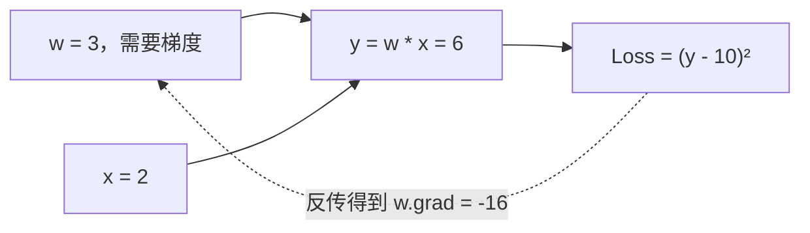
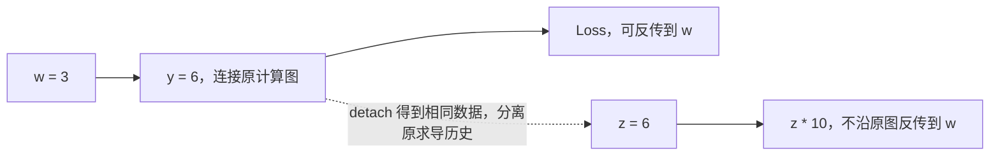

# Day 2：Autograd 自动求导总结

> 按原学习窗口的讲解顺序整理，保留设计动机、例子、反例、推导和逐步代码说明，并收录相关追问。原窗口交互组件转为静态表达，公式适配 GitHub。完整可运行的归档程序见 [code.py](code.py)。 本日以可读取的原总结和详细补充讲解为主体，另补链式法则与 grad_fn 例子。

## 1\. 为什么需要 Autograd？

神经网络训练的目标是通过调整参数，让 Loss 不断下降。

例如：

$$
\hat y=wx,\qquad L=(\hat y-y)^2
$$

假设 `w=3`、`x=2`、`y=10`：

- 预测值：6
- Loss：16
- 梯度：$\frac{\partial L}{\partial w}=-16$

更新参数：

$$
w_{\text{new}}=w-lr\times grad
$$

当 `lr=0.1` 时，`w` 从 3 更新为 4.6，Loss 降为 0.64。

**Autograd 的作用：自动计算 Loss 对模型参数的梯度，而不是自动更新参数。**

## 2\. 计算图与反向传播

```python
import torch

w = torch.tensor(3.0, requires_grad=True)
x = torch.tensor(2.0)
y = torch.tensor(10.0)

pred = w * x
loss = (pred - y) ** 2

loss.backward()

print(w.grad)  # tensor(-16.)
```

运行逻辑：

```text
w、x
  ↓
pred = w*x       前向传播
  ↓
loss = (pred-y)²
  ↓
loss.backward()  反向传播
  ↓
w.grad = -16
```

PyTorch 通过**计算图 + 链式法则**自动计算梯度。

## 3\. 核心 API

| API | 作用 |
|--------|--------|
| `requires_grad=True` | 让 Tensor 参与自动求导 |
| `grad_fn` | 查看 Tensor 关联的反向计算节点 |
| `loss.backward()` | 计算并累积梯度 |
| `w.grad` | 查看参数的梯度 |
| `w.grad = None` | 清空已有梯度 |
| `optimizer.zero_grad()` | 清理优化器管理的参数梯度 |
| `detach()` | 创建不保留原求导历史的 Tensor |
| `torch.no_grad()` | 临时关闭代码块中的梯度记录 |
| `optimizer.step()` | 根据梯度更新参数 |

注意：默认情况下，梯度主要保存在需要梯度的叶子 Tensor 的 `.grad` 中。

## 4\. 梯度累积

```python
w = torch.tensor(2.0, requires_grad=True)

loss = w ** 2
loss.backward()
print(w.grad)  # 4

loss = w ** 2
loss.backward()
print(w.grad)  # 8
```

**每次 `backward()` 会把新梯度累加到 `.grad`，而不是覆盖。**

正常训练每轮需要清理梯度；有意进行梯度累积时除外。

## 5\. detach() 与 no\_grad() 的区别

**detach()：已经计算出了结果，现在要切断新 Tensor 与原计算图的求导关系。**

```python
w = torch.tensor(3.0, requires_grad=True)

y = w * 2
z = y.detach()

print(y.requires_grad)  # True
print(z.requires_grad)  # False
```

**no\_grad()：还没开始计算，就决定这一段不记录梯度。**

```python
with torch.no_grad():
    y = w * 2

print(y.requires_grad)  # False
```

记忆：

- `detach()`：计算之后分离。
- `no_grad()`：计算之前关闭梯度记录。

## 6\. 完整训练代码（必须掌握）

```python
import torch

# 数据
x = torch.tensor(2.0)
y = torch.tensor(10.0)

# 参数
w = torch.tensor(3.0, requires_grad=True)

lr = 0.1

for epoch in range(10):

    # 1. 前向传播
    pred = w * x

    # 2. 计算 Loss
    loss = (pred - y) ** 2

    # 3. 清空梯度
    w.grad = None

    # 4. 反向传播
    loss.backward()

    # 5. 更新参数
    with torch.no_grad():
        w -= lr * w.grad

    print(epoch, w.item(), loss.item())
```

训练过程：

Forward → 计算预测值

Loss → 计算误差

Zero Grad → 清理旧梯度

Backward → 计算梯度

Update → 更新参数

不断重复，逐渐降低 Loss

实际工程中通常使用优化器：

```python
optimizer.zero_grad()

pred = model(x)
loss = loss_fn(pred, y)

loss.backward()
optimizer.step()
```

## 7\. 三个容易犯的错误

1. `loss.backward()` **只计算梯度，不更新参数**。
2. 不要在 `backward()` 前对 Loss 调用 `.item()`，因为它会变成普通 Python 数字，失去求导能力。
3. `loss.backward()` 默认要求 Loss 是单元素 Tensor；如果有多个元素，通常先使用 `.mean()` 或 `.sum()`。

---

**Day 2 最核心的知识：**

$$
\boxed{\text{Forward}\rightarrow\text{Loss}\rightarrow\text{Backward}\rightarrow\text{Update}}
$$

你要真正掌握的是：**PyTorch 通过计算图自动计算梯度，我们再利用梯度更新参数，让模型逐渐学会正确预测。**

这就是后续学习 `nn.Module`、优化器、Transformer 训练和大模型微调的基础。


---

# 补充讲解一 · 为什么累积梯度，怎样更新参数

这两个问题其实是连在一起的。我们还是用一个具体例子讲，不绕弯子。

## 一、为什么 PyTorch 要让梯度自动累积？

**核心原因：允许我们分多次计算梯度，最后合起来更新一次参数。**

举个例子。

假设我们训练 GPT，一共有 100 条训练数据，但是 GPU 显存有限，一次只能处理 10 条。

怎么办？

可以分成 10 批，每批计算一次梯度。

假设某个参数 `w` 在前 3 批数据中得到的梯度分别是：

- 第 1 批：2
- 第 2 批：3
- 第 3 批：-1

如果 PyTorch 每次都覆盖梯度：

```text
第1次 backward → w.grad = 2
第2次 backward → w.grad = 3
第3次 backward → w.grad = -1
```

前面两批计算得到的梯度就丢失了。

但 PyTorch 使用累积机制：

```text
第1次 backward → w.grad = 2
第2次 backward → w.grad = 5
第3次 backward → w.grad = 4
```

这样我们就可以利用所有批次的梯度，统一更新一次参数。

### 代码验证

```python
import torch

w = torch.tensor(2.0, requires_grad=True)

# 第一批数据
loss1 = w ** 2
loss1.backward()

print(w.grad)  # 4

# 第二批数据
loss2 = 3 * w
loss2.backward()

print(w.grad)  # 7
```

为什么是 7？

第一批：

$$
\frac{\partial w^2}{\partial w}=2w=4
$$

第二批：

$$
\frac{\partial 3w}{\partial w}=3
$$

因此：

$$
w.grad=4+3=7
$$

**这就是梯度累积：把多次反向传播算出的梯度加起来。**

实际训练中，如果各批使用平均 Loss，想得到整体 Batch 的平均梯度，就需要根据批次样本数正确加权。对于等大小的 3 个 Micro-batch，通常把每批 Loss 除以 3 再调用 `backward()`。

### 那为什么普通训练又要清空梯度？

因为我们通常希望：

**这一轮只使用这一轮数据得到的梯度更新参数。**

所以正常训练：

```python
optimizer.zero_grad()  # 清空
loss.backward()         # 计算当前梯度
optimizer.step()        # 更新参数
```

而梯度累积训练：

```python
optimizer.zero_grad()

for i in range(3):
    loss = ...       # 每次计算一批数据的 Loss
    (loss / 3).backward()

optimizer.step()
```

前者每批更新一次，后者累积 3 批后更新一次。

---

## 二、`backward()` 不更新参数，那到底谁更新？

答案是：

**`w.grad` 保存梯度，`optimizer.step()` 使用梯度更新参数。**

我们从最简单的数学公式看：

$$
\boxed{w_{\text{new}}=w-lr\times w.grad}
$$

其中：

- `w`：当前参数。
- `w.grad`：`backward()` 计算出来的梯度。
- `lr`：学习率。

你有两种更新方式。

### 方式一：手动更新（理解原理）

```python
import torch

w = torch.tensor(3.0, requires_grad=True)
x = torch.tensor(2.0)
y = torch.tensor(10.0)

loss = (w * x - y) ** 2

loss.backward()

print(w.grad)  # -16

with torch.no_grad():
    w -= 0.1 * w.grad

print(w)  # 4.6
```

这里：

```python
loss.backward()
```

计算出：

```text
w.grad = -16
```

然后：

```python
w -= 0.1 * w.grad
```

才真正把 `w` 从 3 更新到 4.6。

需要 `no_grad()` 是因为我们不希望把参数更新也加入自动求导的计算过程。

### 方式二：使用 optimizer（实际工程）

```python
import torch

w = torch.nn.Parameter(torch.tensor(3.0))

optimizer = torch.optim.SGD([w], lr=0.1)

x = torch.tensor(2.0)
y = torch.tensor(10.0)

optimizer.zero_grad()

loss = (w * x - y) ** 2

loss.backward()

optimizer.step()

print(w.item())  # 4.6
```

重点理解：

```python
optimizer = torch.optim.SGD([w], lr=0.1)
```

相当于告诉优化器：

> 你负责管理参数 w，用 0.1 的学习率更新它。

```python
loss.backward()
```

把计算得到的梯度保存到 `w.grad`。

```python
optimizer.step()
```

优化器读取 `w.grad`，按照 SGD 的更新规则修改 `w`。

对于这里使用的最基础 SGD：

```python
optimizer.step()
```

就相当于：

```python
with torch.no_grad():
    w -= 0.1 * w.grad
```

当然，如果之后使用 Adam、AdamW 等优化器，更新规则会更复杂。

---

## 三、把整个过程串起来

记住这三个 API 的分工：

| 代码 | 做什么 | 是否修改参数 w |
|--------|--------|--------|
| `optimizer.zero_grad()` | 清除上一轮梯度 | 否 |
| `loss.backward()` | 计算梯度，存进 `.grad` | 否 |
| `optimizer.step()` | 读取 `.grad` 并更新参数 | **是** |

最后给你一个问题，检查是不是真的明白了。

假设当前：

```python
w = 5
w.grad = -2
lr = 0.1
```

执行一次普通 SGD 更新：

```python
optimizer.step()
```

更新后的 `w` 是多少？

A. 4.8

B. 5.2

C. -2


# 补充讲解二 · 三个小批怎样更新一次

对！✅ 理解正确！

比如每次输入 1 条样本，连续输入 3 次：

1. 第 1 条：计算梯度，累积。
2. 第 2 条：计算梯度，继续累积。
3. 第 3 条：计算梯度，继续累积。
4. **最后调用一次 `optimizer.step()`，统一更新参数。**

注意：**每条样本都要计算梯度（`backward()`），只是每 3 条才更新一次参数（`step()`）。**

如果想取这 3 条样本的平均梯度，可以让每条样本的 Loss 除以 3 再执行 `backward()`。


---

# 补充讲解三 · detach 与 no_grad 的完整例子

好，那我们重新讲。**先不要记 `detach()` 和 `no_grad()` 的定义。** 你没听懂，是因为前面没有把“为什么需要它们”解释清楚。

我们只用一个例子，把这两个东西彻底搞懂。

# 一、先搞懂：PyTorch 为什么要记录计算过程？

假设我们训练一个特别简单的神经网络：

$$
y=wx
$$

其中：

```python
import torch

w = torch.tensor(3.0, requires_grad=True)
x = torch.tensor(2.0)

y = w * x
```

计算结果很简单：

$$
y=3\times2=6
$$

但是，PyTorch 实际上还做了一件事。

因为 `w` 设置了 `requires_grad=True`，PyTorch 不仅算出了 6，还追踪了：

**这个 6 是通过 w 乘以 x 得到的。**



PyTorch 追踪了计算关系，因此以后可以从 y 反向计算 w 的梯度。

假设后面要计算 Loss：

```python
loss = (y - 10) ** 2

loss.backward()
```

PyTorch 就可以顺着计算关系反向求导，得到 `w.grad = -16`。

**现在记住一个概念就够了：计算图就是 PyTorch 为了以后计算梯度，追踪的运算关系。**

但是问题来了：

有时候，我们只想计算一个结果，根本不需要计算梯度。

这就是 `detach()` 和 `no_grad()` 要解决的问题。

---

# 二、detach() 到底是什么？

先看一个生活化的例子。

你正在训练模型，已经得到一个中间结果：

```python
w = torch.tensor(3.0, requires_grad=True)
x = torch.tensor(2.0)

y = w * x
```

此时：

```text
w = 3
x = 2
y = 6
```

现在，你想把 `y=6` 拿出来做一个额外的统计计算。

比如：

```python
z = y * 10
```

但你不希望这个统计计算与原来的梯度计算关系连接起来。

怎么办？

```python
z = y.detach()
```

注意：

**`detach()` 不是让 y 消失，也不是清空 y 的数值，而是得到一个新的 Tensor，它拥有相同的数据，但不再携带 y 原来的求导关系。**



上面的 y 仍然可以参与原来的反向传播；下面的 z 不再连接到原先的求导路径。

### 直接用代码验证

```python
import torch

w = torch.tensor(3.0, requires_grad=True)

y = w * 2

z = y.detach()

print(y)
print(z)

print(y.requires_grad)
print(z.requires_grad)
```

输出：

```text
tensor(6., grad_fn=<MulBackward0>)
tensor(6.)
True
False
```

发现没有？

|  | y | z |
|--------|--------|--------|
| 数值 | 6 | 6 |
| `requires_grad` | True | False |
| 是否保留原求导关系 | 是 | 否 |

再看：

```python
a = z * 10

print(a.requires_grad)
```

输出：

```text
False
```

也就是说，`z` 后续的普通乘法没有继续追踪原先的梯度关系。

但注意，原来的 `y` 完全没有受到影响。

### 一个特别容易犯的错误

```python
z = y.detach()
```

并不等于把原来的 y 关闭梯度。

它只是产生一个新 Tensor，z 不再保留 y 的求导历史。

而且 z 和 y 默认共享底层数据。如果需要完全独立的一份数据，应使用：

```python
z = y.detach().clone()
```

---

# 三、no\_grad() 又是什么？

现在换一种情况。

你不想等 y 计算出来后再切断梯度关系。

而是：

**我从一开始就知道，接下来这部分计算根本不需要计算梯度。**

比如模型已经训练完毕，现在只是拿它预测结果。

你可以这样写：

```python
import torch

w = torch.tensor(3.0, requires_grad=True)
x = torch.tensor(2.0)

with torch.no_grad():
    y = w * x

print(y)
print(y.requires_grad)
```

输出：

```text
tensor(6.)
False
```

这里的：

```python
with torch.no_grad():
```

你可以理解成给接下来缩进的代码设置一个临时开关：

**这一段代码，不要记录用于自动求导的计算过程。**

离开这个代码块之后，又恢复正常。

例如：

```python
w = torch.tensor(3.0, requires_grad=True)

with torch.no_grad():
    a = w * 2

b = w * 3

print(a.requires_grad)  # False
print(b.requires_grad)  # True
```

为什么？

因为：

```python
with torch.no_grad():
    a = w * 2
```

只在这个代码块内关闭梯度记录。

而：

```python
b = w * 3
```

已经离开了这个代码块，所以恢复了正常的自动求导行为。

---

# 四、detach() 和 no\_grad() 到底有什么区别？

现在你应该能看懂了。

假设你在做菜。

**`detach()`：菜已经做好了，你取出一份成品，只用它的结果，不追溯它原先的制作过程。**

**`no_grad()`：你在开始做一份菜之前，就决定这整个制作环节不需要记录制作过程。**

对应到 PyTorch：

**detach()**

先正常计算：

```python
y = w * x
```

再分离：

```python
z = y.detach()
```

拿到一个已有结果，把它从原来的求导历史中分离出来。

**no\_grad()**

先关闭梯度记录：

```python
with torch.no_grad():
    y = w * x
```

让指定代码块中的运算从一开始就不建立普通自动求导记录。

再总结一下：

| 对比 | detach() | no\_grad() |
|--------|--------|--------|
| 什么时候用 | 已经有了 Tensor | 准备执行一段计算 |
| 作用 | 分离一个 Tensor 的求导历史 | 关闭代码块中的梯度记录 |
| 会不会改变原 Tensor | 不会 | 不会 |
| 典型场景 | 中间结果后处理 | 模型推理、手动参数更新 |

---

# 五、为什么训练代码里面要用 no\_grad()？

联系你 Day 2 学过的代码：

```python
w = torch.tensor(3.0, requires_grad=True)

loss = (w * 2 - 10) ** 2

loss.backward()

with torch.no_grad():
    w -= 0.1 * w.grad
```

为什么更新参数的时候使用 `no_grad()`？

因为前面：

```python
loss.backward()
```

已经算好了梯度。

现在：

```python
w -= 0.1 * w.grad
```

只是根据算好的梯度，手动改变参数值。

**我们只希望更新参数，不希望 PyTorch 把“参数更新”也记录进原来的求导计算关系中。**

而且，在默认梯度模式下直接对需要梯度的叶子 Tensor 执行这种原地更新，会报错。

所以使用：

```python
with torch.no_grad():
    w -= 0.1 * w.grad
```

这就是你现在需要掌握的实际用途。

---

# 六、现在我检查你是否真正理解

这次不让你写复杂代码，我们先做三个判断题。你选完后，我会针对你没理解的地方继续讲。


最后只记住这两句话：

**`detach()`：已有结果，切断它与原来计算图的求导连接。**

**`no_grad()`：准备计算，提前关闭这一段的梯度记录。**

暂时不需要记更复杂的细节，我们先确保你真正理解了这两种机制的区别。

---

## 补充推导 · 沿计算图逐步使用链式法则

```python
a = torch.tensor(2.0, requires_grad=True)
b = torch.tensor(3.0, requires_grad=True)
c = a * b
d = c + 4
loss = d ** 2
print(a.is_leaf, a.grad_fn)  # True, None
print(c.is_leaf, c.grad_fn)  # False，乘法的反向节点
loss.backward()
print(a.grad, b.grad)       # 60、40
```

前向得到 c=6、d=10、loss=100。反向先求 dL/dd=2d=20，再求 dd/dc=1，最后分别乘 dc/da=b=3、dc/db=a=2，所以梯度为60和40。

requires_grad 表示请求参与求导。手动创建的 a、b 是叶子，grad_fn 为 None，依然能得到梯度。c 是运算产生的非叶子，记录相关反向节点，默认不保留自己的 .grad，需要时可在反传前调用 c.retain_grad()。

普通 backward 通常会释放反传所需的中间保存值。同一张图重复反传可能报错。下面两次前向各建立一次计算图，同时累积到同一个叶子参数的 .grad。

```python
w = torch.tensor(2.0, requires_grad=True)
(w ** 2).backward()  # 4
(w ** 2).backward()  # 继续累积为8
```

[code.py](code.py) 来自本地 grad.py，其中两次求导之间使用 w.grad=None，因此打印4、4。训练日志中的 w 是更新后值，Loss 是更新前计算的值。四位小数打印为0.0000时，真实 Loss 仍可能是很小的正数。
