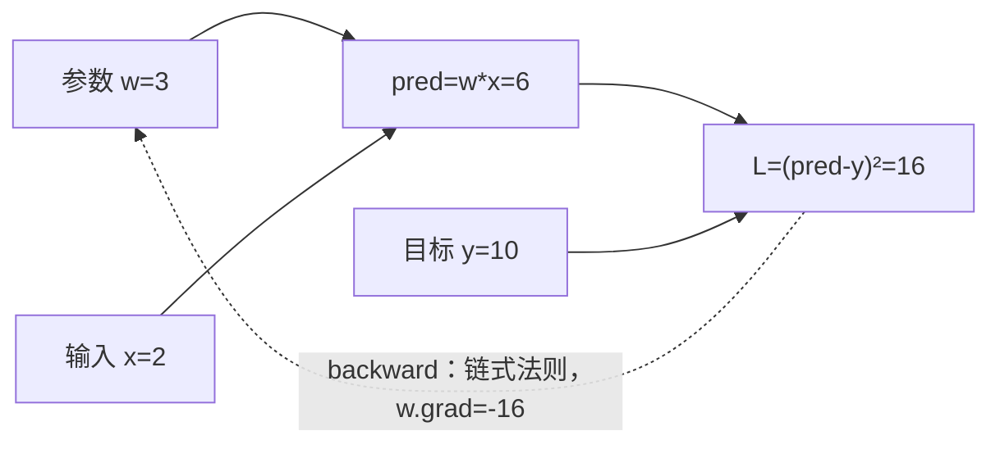

# Day 2 · Autograd 自动求导

**主线：前向算预测 → Loss 衡量误差 → backward 算梯度 → 用梯度更新参数。**

## 1. 计算图：数值从哪里来，梯度就沿哪里回去

以 `w=3, x=2, y=10` 为例，预测 `pred=w*x=6`，损失 `L=(pred-y)²=16`。



链式法则：`dL/dw = 2*(pred-y)*x = -16`。普通 SGD 更新 `w ← w-lr*w.grad`；`lr=0.1` 时 `w=4.6`，重新前向计算后 Loss 为 `0.64`。

## 2. API 分工：算梯度、存梯度、更新参数

| 对象 / 操作 | 含义 | 要点 |
|---|---|---|
| `requires_grad=True` | 请求追踪求导关系 | 需浮点或复数类型；普通梯度模式下生效 |
| `grad_fn` | 结果对应的反向计算节点 | 手动创建的叶子参数通常为 `None`，不代表不能求导 |
| `loss.backward()` | 沿计算图计算并累积梯度 | **不更新参数**；默认从单元素 Loss 开始 |
| `w.grad` | 保存算出的梯度 | 需要梯度的叶子默认保留；非叶子需 `retain_grad()` 才保留 |
| `w.grad = None` | 清理单个参数的旧梯度 | 不是把参数 `w` 清零 |
| `optimizer.zero_grad()` | 清理优化器管理的参数梯度 | 通常每次更新前清理，累积训练除外 |
| `optimizer.step()` | 读取梯度并更新参数 | 不会自动清梯度；Adam 等更新规则不同于普通 SGD |
| `tensor.item()` | 单元素 Tensor → Python 数值 | 用于打印；不能把 Loss 替换成数值再调用 `backward()` |

计算图随前向运算动态构建；普通 `backward()` 后，用于反传的中间保存值通常被释放。下一轮重新前向即可，不要混淆“同一张图重复反传”与“不同前向的梯度累积”。

## 3. 梯度为什么累积？让多小批数据合起来更新一次

`backward()` 对 `.grad` 做加法，不是覆盖。可在显存有限时分批计算，最后统一更新。

| `w=2`，依次执行 | 本次梯度 | `.grad` 结果 | 参数变化？ |
|---|---:|---:|---|
| `(w**2).backward()` | 4 | 4 | 否 |
| 重新计算 `(3*w).backward()` | 3 | 7 | 否 |
| `w.grad = None` | — | None | 否 |

| 训练方式 | 清梯度 | 反传 | 更新 |
|---|---|---|---|
| 普通训练 | 每批开始时 | 每批一次 | 每批一次 |
| 累积 K 批 | 一组开始时 | 每个小批一次 | K 批结束后一次 |

等大小小批、每批 Loss 为均值时，用 `(loss/K).backward()` 得到整组平均梯度；大小不等时按样本数加权。归档代码用 `w.grad=None` 演示清理，所以两次输出都是4；不清理才会累加。

## 4. detach 与 no_grad：一个分离已有结果，一个控制一段计算

设 `w` 需要梯度，`y=w*2`：

| 对比 | `z = y.detach()` | `with torch.no_grad(): z = w*2` |
|---|---|---|
| 作用对象 | 已有 Tensor 的求导历史 | 代码块内普通运算的梯度记录 |
| 结果 | z 与 y 数值相同，z 不连回原图 | 正常计算数值，但不记录这次乘法 |
| 原对象 | y 仍连接原图、可反传 | w 仍需要梯度；离开代码块恢复之前的模式 |
| 数据关系 | z 与 y **共享存储**；独立副本用 `y.detach().clone()` | 结果由代码块中的运算决定 |
| 用途 | 取中间结果做统计、停止某条求导路径 | 推理、手动更新参数 |

两者都不负责清空旧 `.grad`。`detach()` 不会删除原图，也不会把原 y 关闭梯度；`no_grad()` 不会永久冻结 w。`no_grad()` 中显式指定 `requires_grad` 的张量创建函数是例外。

## 5. 训练循环与代码阅读

```python
w.grad = None                 # 清旧梯度
pred = w * x                 # 前向
loss = (pred - y) ** 2        # Loss
loss.backward()              # 算梯度
with torch.no_grad():         # 更新不加入求导记录
    w -= lr * w.grad
```

工程中通常用 `optimizer.zero_grad()` 与 `optimizer.step()` 管理清理和更新。默认梯度模式下，直接原地更新需要梯度的叶子参数会报错；手动更新放在 `no_grad()` 内。

**归档说明**：[code.py](code.py) 原样来自 `grad.py`，包含单参数求导、链式法则、清梯度、detach、no_grad 作用域及10轮训练。链式例子 `a=2,b=3,L=(ab+4)²` 得 `a.grad=60,b.grad=40`。训练日志打印的 w 已更新，Loss 来自更新前；`:.4f` 会让很小的 Loss 显示为 `0.0000`，并非精确为零。脚本运行通过不代替独立练习验收。
