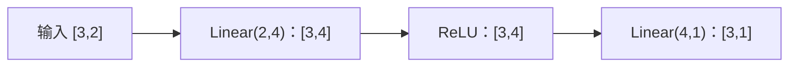

# Day 3 · nn.Module 神经网络模型构建

按《学习Day1张量》的九个部分摘录：每部分保留重点与短例子，完整可运行示例见 [code.py](code.py)。下文代码片段默认已导入 `torch` 和 `torch.nn as nn`。

## 1. 为什么需要 nn.Module？

参数多时，手动维护每层权重、交给优化器、保存加载容易遗漏。`nn.Module` 统一组织计算逻辑、子模块、参数及状态，也能组合成 Transformer 等复杂网络。

| 手动写法 | Module 写法 | 解决什么 |
|---|---|---|
| 分别保存 W、b | `self.fc = nn.Linear(2, 1)` | 注册层和其中的参数 |
| 手写参数列表 | `model.parameters()` | 递归获取已注册参数 |
| 分别保存各权重 | `model.state_dict()` | 统一获取模型状态 |

**例子**：Day2 手动管理一个 w；多层网络可用 `self.fc1`、`self.fc2` 组织各层，不必逐个维护其权重列表。

## 2. __init__、self 与 forward

| 写法 | 重点 |
|---|---|
| `class Model(nn.Module)` | 继承 PyTorch 模型基类 |
| `super().__init__()` | 先初始化父类的注册机制，再赋值子模块和参数 |
| `self.fc = ...` | 将层保存到当前实例，并注册为子模块；局部变量 `fc` 不会自动注册到实例 |
| `__init__` | 创建实例时初始化层；通常不要在 forward 中反复新建层 |
| `forward` | 描述每次输入如何得到输出 |
| `model(x)` | 经过 Module 调用流程再执行 forward，保留 Hook 等机制 |

**例子**：

```python
class SimpleModel(nn.Module):
    def __init__(self):
        super().__init__()
        self.linear = nn.Linear(2, 1)

    def forward(self, x):
        return self.linear(x)

model = SimpleModel()
y = model(torch.tensor([[2.0, 3.0]]))  # [1,2] → [1,1]
```

`self` 是当前实例；内部 `self.linear` 与外部 `model.linear` 指同一层。使用 `model(x)`，直接调 `model.forward(x)` 会绕过模型的部分调用管理。

## 3. nn.Linear：变换最后一维

`nn.Linear(in_features, out_features)` 默认创建权重和偏置，计算 `Y = X @ W.T + b`。

| 对象 | Shape | `Linear(2,1)` 的例子 |
|---|---|---|
| X | `[..., in_features]` | `[1,2]` |
| W | `[out_features, in_features]` | `[1,2]` |
| b | `[out_features]` | `[1]` |
| Y | `[..., out_features]` | `[1,1]` |

每行 W 对应一个输出神经元，所以计算时转置 W。前面的批次/序列维不变：`[2,10,512] → Linear(512,128) → [2,10,128]`；对应 Transformer 的特征投影。

**例子**：输入 `[2,3]`，权重 `[4,5]`，偏置1，输出 `2*4+3*5+1=24`。

```python
linear = nn.Linear(2, 1)
with torch.no_grad():
    linear.weight.copy_(torch.tensor([[4.0, 5.0]]))
    linear.bias.fill_(1.0)
print(linear(torch.tensor([[2.0, 3.0]])).item())  # 24
```

`copy_`、`fill_` 是原地修改；手动设置参数放在 `no_grad()` 内，避免记录更新过程。

## 4. nn.Parameter：能求导不等于已注册

| 赋给 Module 属性的对象 | 能否求导 | 是否自动进入 parameters() |
|---|---|---|
| 普通浮点 Tensor | 设置 `requires_grad=True` 后可以 | 否 |
| `nn.Parameter` | 默认 `requires_grad=True` | 是 |
| `nn.Linear` 子模块 | 内部权重/偏置默认可以 | 是，递归找到其 Parameter |

**例子**（在 `__init__` 中、父类初始化之后）：

```python
self.a = torch.tensor(3.0, requires_grad=True)  # 能求导，未注册
self.w = nn.Parameter(torch.tensor(3.0))        # 注册参数
```

此时 `dict(model.named_parameters())` 包含 w、不包含 a。`nn.Linear` 已包装好 Parameter，无须再手动包装其 weight/bias。优化器只管理传给它的参数。

## 5. parameters()：查参数、计数、交给优化器

**例子**：两层 `Linear(2,4)` 与 `Linear(4,1)`。

| 参数 | Shape | 元素数 |
|---|---|---:|
| fc1.weight | `[4,2]` | 8 |
| fc1.bias | `[4]` | 4 |
| fc2.weight | `[1,4]` | 4 |
| fc2.bias | `[1]` | 1 |
| 合计 | — | 17 |

```python
for name, p in model.named_parameters():
    print(name, p.shape)
total = sum(p.numel() for p in model.parameters())
optimizer = torch.optim.AdamW(model.parameters(), lr=0.001)
```

`parameters()` 返回参数迭代器；`named_parameters()` 同时返回名字。生成器表达式逐个取参数的元素数再求和。`step()` 使用梯度更新参数，`parameters()` 本身不执行训练，也不只返回可训练参数；只统计可训练量时加 `if p.requires_grad`。

## 6. Sequential 与 ReLU

**例子**：

```python
model = nn.Sequential(nn.Linear(2, 4), nn.ReLU(), nn.Linear(4, 1))
y = model(torch.randn(3, 2))  # [3,1]
```



`ReLU(x)=max(0,x)`，例如 `[-2,0,3] → [0,0,3]`。只有线性层叠加仍可合并成一个仿射变换；激活函数引入非线性表达能力。

| 结构 | 选择 | 原因 |
|---|---|---|
| Linear → ReLU → Linear | Sequential | 上一层输出顺序传给下一层 |
| 残差、分支、Attention | 自定义 Module | 需要显式表达复杂数据流，如 `x + attn(x)` |

## 7. state_dict：保存状态，加载到匹配的结构

保存已注册参数及持久化缓冲区，不包含 Python 类定义，也不是完整的续训检查点。

**例子**：上节 Sequential 的键为 `0.weight/0.bias/2.weight/2.bias`；ReLU 位于第1层但无权重，因此没有 `1.weight`。

```python
torch.save(model.state_dict(), "model_weights.pth")
new_model = nn.Sequential(nn.Linear(2, 4), nn.ReLU(), nn.Linear(4, 1))
state = torch.load("model_weights.pth", map_location="cpu", weights_only=True)
new_model.load_state_dict(state)
```

先建立结构，再加载匹配的键和 Shape。`load_state_dict` 修改已有模型，返回加载结果信息，不返回新模型；不要写 `new_model = new_model.load_state_dict(state)`。保存后用同一输入比较新旧输出，检查恢复是否一致；断点续训通常还要保存优化器等状态。

## 8. 完整工程实践：学习 y=2*x1+3*x2+1

| 步骤 | 本次例子与重点 |
|---|---|
| 初始化 | `manual_seed(42)`；`MyModel` 内为 Linear(2,16) → ReLU → Linear(16,1) |
| 数据 | `X=torch.rand(200,2)`；`y=2*X[:,0:1]+3*X[:,1:2]+1` |
| 损失/优化器 | MSELoss 衡量均方误差；Adam 接收 `model.parameters()`，lr=0.01 |
| 每轮训练 | `pred=model(X)` → Loss → zero_grad → backward → step，共500轮 |
| 预测 | `[0.5,0.8]` 的理论答案4.4；在 no_grad 中预测，应接近而非精确等于4.4 |
| 保存/加载 | 建立同结构 MyModel，加载权重，再比较预测 |

**Shape 陷阱例子**：`X[:,0]` 为 `[200]`，`X[:,0:1]` 为 `[200,1]`。标签应与预测 `[200,1]` 一致，否则相减可能广播成 `[200,200]`，误算样本间误差。

完整代码见 [code.py](code.py)：先运行第1–7部分短例子，再运行会话第八部分的训练。整理时新增短例子，权重路径改为脚本旁的 `model_weights.pth`（已被 gitignore 忽略）；训练结构、数据、种子、轮数和优化器保留教学设置。日志的 Loss 来自本轮参数更新前。

## 9. 独立练习与验收

原会话的交互题目正文/答案不可读取，不能据此记录“验收通过”。以下是依据该部分验收目标整理的**自检例子**，不是原题复原：

```text
独立写出 Linear(2,16) → ReLU → Linear(16,1)，输入 [5,2]。
应能说明：输出 [5,1]；参数量 (2*16+16)+(16*1+1)=65。
```

- 解释 self、super 初始化、model(x) 与 forward 的关系。
- 区分普通 Tensor 与 Parameter，列出参数名/Shape 并统计数量。
- 完成训练、保存、加载，用同一输入验证输出一致。

来源说明：本日没有发现本地独立练习源文件，代码与笔记来自《学习Day1张量》Day3 教学内容的整理；实际运行结果不代替本人独立验收。
