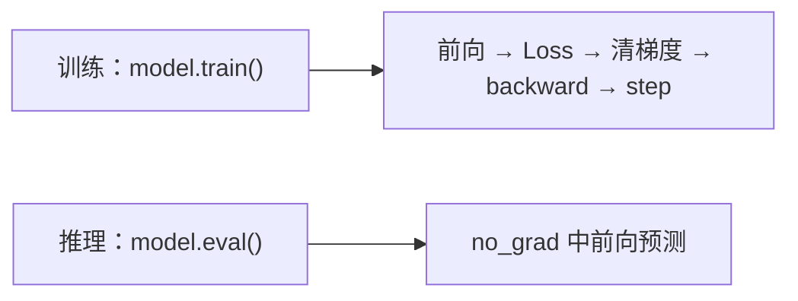

# Day 4 · 设备管理与模型模式

按《学习Day1张量》的八个部分提炼重点与例子；完整代码见 [code.py](code.py)。代码片段默认导入 `torch`、`torch.nn as nn`。

## 1. CPU、GPU 与 CUDA

| 名称 | 是什么 | 例子 / 用途 |
|---|---|---|
| CPU | 通用计算硬件，擅长控制逻辑 | 数据准备、程序调度，也能训练模型 |
| GPU | 适合大量并行数值运算的硬件 | `X @ W`、Attention、FFN、反向传播 |
| CUDA | NVIDIA 的 GPU 并行计算平台 | PyTorch 通过 CUDA 后端使用 NVIDIA GPU |

GPU 不等于 CUDA，也不是所有 GPU 都支持 CUDA；Apple Silicon 等还有 MPS 后端。小任务可能受数据搬运开销影响，不保证 GPU 总更快。

**例子**：先判断当前 PyTorch 环境能否用 CUDA，再查询 GPU 名称。

```python
print(torch.cuda.is_available())
print(torch.cuda.device_count())
if torch.cuda.is_available():
    print(torch.cuda.get_device_name(0))
```

False 仅表示当前环境不能用 CUDA，也可能涉及驱动或安装版本，不代表一定没有 GPU。注意 **`is_available()` 必须加括号**；不加括号拿到的是函数对象，条件判断会错误地当作真。

## 2. device 与 .to(device)：模型、输入、标签要匹配

```python
device = torch.device("cuda" if torch.cuda.is_available() else "cpu")
model = nn.Linear(2, 1).to(device)
X = torch.randn(4, 2).to(device)
y = torch.randn(4, 1).to(device)
loss = nn.MSELoss()(model(X), y)
```

`A if condition else B` 是 Python 条件表达式；`cuda:0` 表示第0号 CUDA GPU。普通运算中，模型参数、输入和参与损失计算的标签通常必须在兼容设备上。

| 操作 | 要点 | 查看方式 |
|---|---|---|
| `x = x.to(device)` | 接收返回 Tensor；原 Tensor 不会因跨设备转换而自动替换 | `x.device` |
| `model.to(device)` | 原地移动注册参数与 Buffer，并返回模型自身 | `next(model.parameters()).device` |
| 先移动模型，再创建优化器 | 让优化器持有目标设备上的参数 | `optimizer = Adam(model.parameters(), ...)` |

普通 Tensor 属性未注册时不会自动随模型迁移。只检查第一个参数也不足以证明所有状态都在同一设备，调试时可遍历 `named_parameters()` 和 `named_buffers()`。

## 3. train() 与 eval()：切换模块行为

模式递归传到子模块，可以通过 `model.training` 查看；`eval()` 相当于 `train(False)`。两者本身不训练、不更新参数，也不切换梯度记录。

| 模块 | train() | eval() |
|---|---|---|
| Dropout | 随机置零；保留元素乘 `1/(1-p)` | 原样通过，不置零、不缩放 |
| BatchNorm（默认跟踪运行统计量） | 用当前批统计量归一化，并更新运行统计量 | 用已积累的运行统计量，不更新 |
| 普通 Linear | 正常线性计算 | 正常线性计算 |

**Dropout 例子**：

```python
dropout = nn.Dropout(p=0.5)
x = torch.ones(10)
dropout.train()
print(dropout(x))  # 每个元素为0或2，不保证恰好一半为0
dropout.eval()
print(dropout(x))  # 全部为1
```

随机屏蔽减少对少数特征的依赖；缩放保持期望值。**BatchNorm 例子**：`nn.BatchNorm1d(2)` 的 `running_mean` 会在训练前向中更新，切到 eval 后保持不变；`track_running_stats=False` 时评估也使用当前批统计量。

## 4. eval 与 no_grad：两个独立开关

| 操作 | 影响 Dropout / BatchNorm 行为 | 关闭普通运算的梯度记录 |
|---|---|---|
| `model.eval()` | 是 | 否 |
| `with torch.no_grad():` | 否 | 是，退出后恢复之前状态 |

**例子**：Linear 的参数默认需要梯度，eval 下输出仍能连接计算图。

```python
model = nn.Linear(2, 1)
x = torch.ones(1, 2)
model.eval()
print(model(x).requires_grad)  # True
with torch.no_grad():
    print(model(x).requires_grad)  # False
```



推理一般两者一起用，控制正确行为并减少计算图内存开销。只有 no_grad 时，train 模式的 Dropout 仍随机、BatchNorm 仍可能更新运行统计量；eval 不等于冻结参数。

## 5. Parameter 与 Buffer：两类注册状态

| 对比 | Parameter | Buffer |
|---|---|---|
| 作用 | 通常通过梯度训练的权重/偏置 | 需模型管理的非普通优化参数状态，如 BatchNorm 运行均值 |
| `parameters()` | 包含；也可能被设为不求导 | 不包含 |
| `named_buffers()` | 不包含 | 包含 |
| `state_dict()` | 包含 | 默认持久化的 Buffer 包含 |
| 随 `model.to(device)` 移动 | 是 | 是 |

**例子**（在 Module 的 `__init__` 中、调用 super 后）：

```python
self.weight = nn.Parameter(torch.tensor([2.0]))
self.register_buffer("running_value", torch.tensor([10.0]))
self.register_buffer("temporary", torch.tensor([1.0]), persistent=False)
```

若 forward 返回 `x*self.weight+self.running_value`，x=3 时输出16。`running_value` 在 named_buffers 和 state_dict 中；`temporary` 随设备移动，但不进入 state_dict。Buffer 不是必然永不改变，它可由前向逻辑更新，只是不由 `model.parameters()` 自动交给优化器。

**本次代码细节**：第一个 MyModel 注册了 weights 和 running_value，但 forward 只用 self.net，所以 weights 不参与 Loss，梯度为 None；后面重定义的训练 MyModel 含 Linear/ReLU/Dropout，没有 Buffer，最终缓冲区列表为空是正常现象。

## 6. 随机种子与可复现性

| 设置 | 控制对象 |
|---|---|
| `random.seed(42)` | Python random |
| `np.random.seed(42)` | NumPy 传统全局随机数生成器 |
| `torch.manual_seed(42)` | PyTorch 各设备随机数 |
| `torch.cuda.manual_seed_all(42)` | 显式设置所有 CUDA 设备的种子 |

在创建模型、生成数据前设置；相同环境中也需保持随机调用顺序一致。

**例子**：重置种子后生成相同序列，而不是让每次随机调用都返回同一个值。

```python
torch.manual_seed(42)
a = torch.rand(3)
torch.manual_seed(42)
b = torch.rand(3)
print(torch.equal(a, b))  # True
```

种子不保证跨硬件、CUDA/PyTorch 版本完全一致；某些算子本身不确定。`torch.use_deterministic_algorithms(True)` 可要求确定性算法，但可能变慢或在无确定实现时报错，部分 CUDA 算子还需额外环境配置。

## 7. 完整实践：设备一致 → 训练 → 评估 → 保存

| 步骤 | 本次代码与例子 |
|---|---|
| 选择设备 | CUDA 可用则用 GPU，否则 CPU；模型、X、y 都移动 |
| 网络 | Linear(2,16) → ReLU → Dropout(0.2) → Linear(16,1) |
| 数据 | X `[200,2]`；`y=2*X[:,0:1]+3*X[:,1:2]+1`，为 `[200,1]` |
| 训练 | train 模式，MSELoss + Adam(lr=0.01)，200轮 |
| 评估 | eval + no_grad；输入 `[0.5,0.8]`，理论答案4.4 |
| 查看状态 | 遍历 named_parameters / named_buffers 检查名称、Shape、设备 |
| 保存 | state_dict 保存参数和持久化 Buffer，权重文件不入 Git |

Dropout 使训练 Loss 有波动，训练/评估行为不同，预测不要求恰好等于4.4。日志 Loss 是本轮更新前的值。

**归档改动**：code.py 来自本地 device_and_mode.py，保留原演示和训练流程；只修正两处漏括号的 `is_available()`，并将保存路径改为脚本旁 `model_weights.pth`，避免覆盖根目录原权重。原文件保留。

## 8. 独立练习与验收

原会话交互练习的题目/答案不可读取，不记录为独立验收通过。以下为按学习目标整理的自检例子：

| 自检任务 | 应能说明 / 观察到 |
|---|---|
| 无 CUDA 时运行 | 自动选择 CPU，不访问 GPU 名称 |
| 比较 Dropout 两种模式 | train 输出随机；eval 与输入一致 |
| eval 下反传，再用 no_grad | eval 仍可求导；no_grad 不记录这次前向 |
| 注册持久/非持久 Buffer | 都随设备移动，只有持久 Buffer 进入 state_dict |
| 重置种子重复生成数据 | 同环境、同调用顺序下结果一致 |

运行成功验证的是脚本与机制，不代表独立练习已完成。后续模块的逐日计划尚未记录，不预写学习成果。
