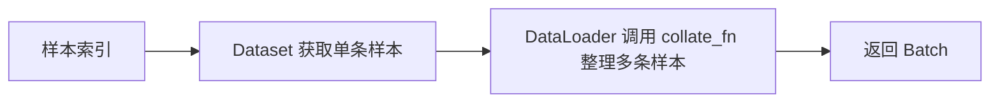

# Day 5 · Dataset 数据集

## 1. 一条样本怎样取出来

Dataset 统一描述样本的获取方式。文本分类的一条样本同时包含文本和对应标签。

```python
sample = {"text": "I love AI", "label": 1}
```

| 操作 | 结果 | 用途 |
|---|---|---|
| `dataset[0]` | 第一条文本与标签的字典 | 根据索引取样本 |
| `len(dataset)` | 样本总数 | 确定数据规模 |
| `dataset[i]["label"]` | 第 i 条的标签 | 保持输入与标签对应 |

## 2. 三个方法怎样配合

```python
class TextDataset(Dataset):
    def __init__(self, texts, labels):
        if len(texts) != len(labels):
            raise ValueError("文本和标签数量必须一致")
        self.texts = texts
        self.labels = labels

    def __len__(self):
        return len(self.texts)

    def __getitem__(self, index):
        return {"text": self.texts[index], "label": self.labels[index]}
```

| 方法 | 何时调用 | 重点 |
|---|---|---|
| `__init__` | `TextDataset(texts, labels)` | 保存实例数据、检查数量 |
| `__len__` | `len(dataset)` | 使用 self.texts，保证每个实例有自己的长度 |
| `__getitem__` | `dataset[index]` | 用同一个 index 获取文本与标签 |

`self` 指当前对象。`sample["text"]` 是字典按键读取，`self.texts[index]` 是列表按位置读取。列表越界会抛出 IndexError。

## 3. 继承 Dataset 与 Python 特殊方法

学习窗口中反复讨论了这两个机制。

| 机制 | 由什么决定 | 例子 |
|---|---|---|
| 方括号索引 | Python 的 `__getitem__` 协议 | `obj[0]` 调用相应特殊方法 |
| len 调用 | Python 的 `__len__` 协议 | `len(obj)` 获取长度 |
| Dataset 类型身份 | `class TextDataset(Dataset)` | 接入 PyTorch 数据集类型体系和基类扩展行为 |
| 具体读样本逻辑 | 子类实现 | 可以读列表，也可按需读文件 |

普通类实现上述方法也能按索引获取样本，并通常可用于索引式 DataLoader。继承 Dataset 提供明确的类型关系与接口约定。基类的 `__getitem__` 默认抛出 NotImplementedError，样本读取逻辑由子类实现。

## 4. 遍历与数据划分

```python
for i in range(len(dataset)):
    print(dataset[i])

train_dataset, val_dataset = random_split(
    dataset, [4, 2],
    generator=torch.Generator().manual_seed(42)
)
```

| 项目 | 本次例子 |
|---|---|
| 原始数据 | 6条文本及标签 |
| 划分长度 | 训练4条，验证2条，总和为6 |
| 返回对象 | 两个 Subset，以索引引用原 Dataset |
| 固定划分 | 独立 Generator 的种子为42 |

划分保留文本和标签的对应关系。同环境、同数据顺序下使用相同种子可重复得到相同索引。random_split 随机分组，类别比例需要另行检查，训练集和验证集用于后续训练与评估。

## 5. 与 DataLoader、Collator 的调用关系



Dataset 定义单条样本，DataLoader 管理取样与批量加载，collate_fn 在加载过程中整理一批样本。文本的 Tokenization 和动态 Padding 安排在 Day7–8。

## 代码来源与运行

[code.py](code.py) 来自本地 dataset.py，保留6条原始数据与4/2划分。整理时将 `__len__` 中的全局 texts 改为 self.texts，并增加文本/标签数量检查。原始文件保留，两个修正均已验证。
