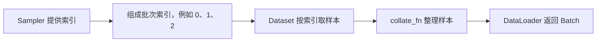

# Day 6 · DataLoader 批量数据加载

## 1. 为什么需要批量加载

Dataset 按索引取一条样本。DataLoader 管理读取顺序、批次、多进程加载，并调用 collate_fn 整理样本。

```python
loader = DataLoader(dataset, batch_size=3, shuffle=False)
for batch in loader:
    print(batch["text"], batch["label"])
```

创建 loader 时配置加载方式，遍历时才逐批读取。原代码共8条样本，顺序批次大小为3、3、2。

## 2. Batch、Batch Size 与训练

| 术语 | 含义 | 例子 |
|---|---|---|
| Dataset 大小 N | 数据集样本总数 | 1000条 |
| Batch Size B | 每个完整批次样本数 | 32条 |
| Batch | 本次一起交给模型的样本 | 前向 → Loss → backward → step |
| Epoch | 完整遍历一次数据 | 保留尾批时共32批，最后8条 |

常规训练每批更新一次参数，梯度累积时可多批更新一次。对于普通索引式 Dataset，保留尾批的批次数是 `ceil(N/B)`，丢弃尾批则为 `floor(N/B)`。

## 3. Shuffle 随机读取顺序

| 设置 | 使用场景 | 行为 |
|---|---|---|
| `shuffle=True` | 通常用于训练集 | 每轮遍历随机排列样本索引 |
| `shuffle=False` | 通常用于验证/测试 | 依次读取 |

原始数据的文本/标签对应关系保留。随机打乱可以减少排列顺序对训练的影响，每批的类别组成仍可能不均衡。例子中正负样本混排后，某批也可能全是正样本。

## 4. Sampler 提供样本索引



| Sampler | 读取方式 | 常见配置 |
|---|---|---|
| SequentialSampler | 顺序索引 | shuffle=False |
| RandomSampler | 随机索引，默认无放回 | shuffle=True 或显式指定 sampler |

```python
sampler = RandomSampler(dataset)
loader = DataLoader(dataset, batch_size=2, sampler=sampler)
```

显式 sampler 与 shuffle=True 互斥，选择一种索引控制方式。

## 5. num_workers 控制加载进程数

| 参数 | 行为 | 注意事项 |
|---|---|---|
| `num_workers=0` | 主进程读取和预处理 | 当前学习代码使用此配置 |
| `num_workers=4` | 4个工作进程参与加载 | 有进程、内存、通信开销，应按实际测量调整 |

多进程可减少读取/预处理导致的 GPU 等待。Windows 使用多进程时，Dataset 类定义在模块顶层，创建和遍历 loader 的入口放入 `if __name__ == "__main__":` 保护。当前脚本的 workers 为0，可直接运行。

## 6. pin_memory 与数据搬运

```python
loader = DataLoader(dataset, batch_size=32, pin_memory=True)
# Batch 中数值 Tensor 可随后传往 CUDA
labels = batch["label"].to("cuda", non_blocking=True)
```

| 配置 | 作用 |
|---|---|
| pin_memory=True | 尝试把返回的 Tensor 放进锁页 CPU 内存 |
| .to("cuda") | 实际执行设备传输 |
| non_blocking=True | 在条件允许时支持异步传输 |

字符串保持文本格式，锁页主要作用于 Tensor。CPU 训练通常无需开启，具体传输收益需测量。当前代码使用 pin_memory=False。

## 7. drop_last 处理不足一批的样本

| N=10、B=4 | 批次大小 | 批次数 | 本轮样本数 |
|---|---|---:|---:|
| drop_last=False | 4、4、2 | 3 | 10 |
| drop_last=True | 4、4 | 2 | 8 |

评估通常保留尾批以覆盖所有样本。某些需要固定批大小的训练场景会舍弃尾批，配合 shuffle 后每轮被舍弃的样本可能不同。

## 8. 完整代码与读取流程

[code.py](code.py) 原样来自本地 dataloader.py，依次演示顺序加载、随机加载、显式 RandomSampler、drop_last 和批次数统计。

| 本次配置 | 结果 |
|---|---|
| N=8，batch_size=3，drop_last=False | 3批，大小3/3/2 |
| N=8，batch_size=3，drop_last=True | 2批，大小3/3 |
| N=8，batch_size=2，RandomSampler | 4批，默认每个样本出现一次 |

`enumerate(loader)` 同时返回批次编号和 Batch，编号从0开始。`len(dataset)` 是样本数，普通配置下 `len(loader)` 是批次数。

## 9. default_collate 如何组成 Batch

```python
# Dataset 返回的两条样本
{"text": "I love AI", "label": 1}
{"text": "I hate AI", "label": 0}
# 默认整理结果
{"text": ["I love AI", "I hate AI"], "label": torch.tensor([1, 0])}
```

默认 collate 按字典同名字段合并，字符串组成序列，数值标签转换成 Tensor，等形状 Tensor 可以堆叠。变长 Token ID 序列需要在 Day7–8 中编码并处理 Padding。

## 10. API 速查

| API / 参数 | 负责什么 |
|---|---|
| Dataset | 如何获取单条样本 |
| DataLoader | 按配置加载并返回 Batch |
| batch_size | 批次大小 |
| shuffle / sampler | 样本读取顺序 |
| num_workers | 加载工作进程数 |
| pin_memory | 锁页 CPU Tensor 内存 |
| drop_last | 尾批取舍 |
| collate_fn | 将样本列表整理成 Batch，默认 default_collate |

学习来源为《学习Dataset数据集》的 Day6 讲解。运行核对数据覆盖、标签配对和批次大小，当前数据保留原始字符串，后续按计划继续 Tokenization 与 Data Collator。
