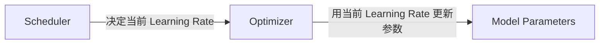

# Day 16｜Learning Rate Scheduler 学习率调度器

(模块四 · 第 4/4 天)

今天是模块四的最后一天，也是最值得掌握的内容之一。

之前你已经学过：

- SGD、AdamW：如何根据梯度更新参数
- Learning Rate：学习率决定参数更新幅度

今天我们解决一个新问题：

**为什么学习率不应该始终保持不变？为什么大模型训练常用 Warmup + Cosine Decay？**

今天主要掌握三个内容：原理、PyTorch Scheduler 的使用、完整代码实践。

## 一、从一个简单例子理解 Scheduler

假设我们训练一个模型，共进行 1000 个 Step。

如果始终使用：

```python
optimizer = torch.optim.AdamW(
    model.parameters(),
    lr=0.001
)
```

那么第 1 步和第 1000 步，基础学习率都是 `0.001`。

但训练不同阶段的需求可能不同。

| 训练阶段 | 我们希望怎样更新参数？ |
|--------|--------|
| 刚开始 | 先用较小学习率，避免初期更新过猛 |
| 训练中期 | 使用较大学习率，推动模型有效学习 |
| 训练后期 | 逐渐减小学习率，让参数调整更加精细 |

这就引出了 **Learning Rate Scheduler（学习率调度器）**。

它的作用很简单：

**按照预先设定的规则，动态调整优化器的学习率。**

例如：

```text
Step 1       lr = 0.00001
Step 100     lr = 0.001
Step 500     lr = 0.0006
Step 1000    lr = 0.00001
```

这些数字只是示意，不是固定规则。

---

## 二、四种常见学习率调度策略

### 1\. Warmup（学习率预热）

刚开始使用较小学习率，再逐渐增大。

例如，设置：

```python
max_lr = 0.001
warmup_steps = 100
```

线性 Warmup 的一个常见公式：

$
lr(t)=lr_{\max}\frac{t}{T_{\text{warmup}}}
$

其中 $t$ 从 0 开始计数。

| Step | Learning Rate |
|--------|--------|
| 0 | 0 |
| 25 | 0.00025 |
| 50 | 0.00050 |
| 75 | 0.00075 |
| 100 | 0.00100 |

**为什么需要 Warmup？**

模型刚初始化时，参数和优化器内部统计量尚未稳定。尤其是 AdamW 的一阶矩、二阶矩都需要逐步建立有效的历史估计。

虽然 Adam 已经有偏差修正，但这并不意味着训练初期一定适合直接使用较大学习率。

Warmup 的目标就是让训练初期的参数更新更加平稳。

### 2\. Linear Decay（线性衰减）

Warmup 结束后，让学习率匀速下降。

$
lr(t)=lr_{\max}(1-p)
$

其中 $p$ 是衰减阶段的进度，从 0 变化到 1。

例如：

```text
lr = 0.0010
lr = 0.0008
lr = 0.0006
lr = 0.0004
lr = 0.0002
lr = 0.0000
```

特点：简单、直观，常用于 Transformer 模型训练和微调。

### 3\. Cosine Decay（余弦衰减）

它同样让学习率从较大值逐渐下降，但不是直线，而是按照余弦曲线变化。

$
lr(t)=lr_{\min}+
\frac{1}{2}(lr_{\max}-lr_{\min})
\left[1+\cos(\pi p)\right]
$

其中 $p$ 表示衰减阶段的进度。

你不需要手算余弦值，理解曲线形状就够了。

### Warmup + 三种学习率策略对比

> 原窗口此处为交互图与滑块，GitHub 中改为静态表格，保留比较含义。原滑块控制 Warmup 占总步数比例，范围 5%～40%，步长 5%。

| Warmup 后的衰减进度 p | 固定 LR / 峰值 | Linear / 峰值 | Cosine / 峰值（最低 10%） |
|---|---|---|---|
| 0% | 1.0000 | 1.0000 | 1.0000 |
| 25% | 1.0000 | 0.7500 | 0.8682 |
| 50% | 1.0000 | 0.5000 | 0.5500 |
| 75% | 1.0000 | 0.2500 | 0.2318 |
| 100% | 1.0000 | 0.0000 | 0.1000 |

示意：三种策略先执行线性 Warmup。固定 LR 表示 Warmup 后保持不变；Cosine 的最低学习率为峰值的 10%，Linear 下降至 0。改变 Warmup 占比，会改变预热结束位置与后续衰减步数。

尝试切换 Linear 和 Cosine：

- Linear：学习率匀速下降。
- Cosine：开始和结束阶段下降更平缓，中间下降更快。

Cosine Decay 在大模型预训练中非常常见，通常也会设置一个非零的最低学习率，而不一定衰减到 0。

### 4\. StepLR（阶梯式衰减）

例如每隔 5 个 Epoch，把学习率乘以 0.1：

```text
Epoch 1–5     lr = 0.01
Epoch 6–10    lr = 0.001
Epoch 11–15   lr = 0.0001
```

PyTorch：

```python
scheduler = torch.optim.lr_scheduler.StepLR(
    optimizer,
    step_size=5,
    gamma=0.1
)
```

这里：

- `step_size=5`：每调用 5 次 `scheduler.step()` 衰减一次。
- `gamma=0.1`：每次变为原来的 10%。

如果每个 Epoch 调用一次，那么就是每 5 个 Epoch 衰减。

---

## 三、PyTorch 的 Scheduler 怎么使用？

这一部分是今天最重要的工程知识。

### 1\. Optimizer 与 Scheduler 的区别

```python
optimizer = torch.optim.AdamW(
    model.parameters(),
    lr=0.001
)
```

Optimizer 负责更新模型参数。

```python
scheduler = torch.optim.lr_scheduler.StepLR(
    optimizer,
    step_size=5,
    gamma=0.1
)
```

Scheduler 负责修改 Optimizer 使用的学习率。

它们的关系：



### 2\. `scheduler.step()` 应该在哪里调用？

这是你必须掌握的知识。

如果使用 StepLR 按 Epoch 更新：

```python
for epoch in range(num_epochs):

    for batch_x, batch_y in loader:

        optimizer.zero_grad()

        logits = model(batch_x)

        loss = criterion(logits, batch_y)

        loss.backward()

        optimizer.step()

    scheduler.step()
```

这里 `scheduler.step()` 在每个 Epoch 结束时调用一次。

但大模型训练常用的 Warmup + Cosine Decay，通常按 **Optimizer Step** 更新：

```python
for epoch in range(num_epochs):

    for batch_x, batch_y in loader:

        optimizer.zero_grad()

        logits = model(batch_x)

        loss = criterion(logits, batch_y)

        loss.backward()

        optimizer.step()

        scheduler.step()
```

注意顺序：

```python
optimizer.step()
scheduler.step()
```

先更新参数，再让 Scheduler 设置下一次更新的学习率。

如果以后使用 Gradient Accumulation，每几个 Batch 才执行一次 `optimizer.step()`，那么 Scheduler 通常也只在真正发生参数更新时调用。

---

## 四、核心代码：用 LambdaLR 实现 Warmup + Cosine Decay

现在学习今天最值得掌握的代码。

`LambdaLR` 允许我们自定义一个函数，计算当前学习率相对于初始学习率的倍数。

```python
scheduler = torch.optim.lr_scheduler.LambdaLR(
    optimizer,
    lr_lambda=lr_lambda
)
```

例如：

```python
def lr_lambda(step):
    return 0.5
```

如果优化器基础学习率是：

```python
lr = 0.001
```

则调度后的学习率：

```text
0.001 × 0.5 = 0.0005
```

**LambdaLR 不要求你直接返回学习率，而是返回学习率倍数。**

### 我们实现一个真正的 Warmup + Cosine

假设：

```python
total_steps = 1000
warmup_steps = 100
```

目标：

- 前 100 Step：学习率从小逐渐增加。
- 后 900 Step：学习率按 Cosine 曲线逐渐下降。

```python

import math
import torch

# 一个简单模型
model = torch.nn.Linear(2, 1)

# 基础学习率
max_lr = 0.001

optimizer = torch.optim.AdamW(
    model.parameters(),
    lr=max_lr
)

total_steps = 1000
warmup_steps = 100
min_lr_ratio = 0.1

def lr_lambda(step):

    # 阶段一：Warmup
    if step < warmup_steps:
        return (step + 1) / warmup_steps

    # 阶段二：Cosine Decay
    progress = (
        step - warmup_steps + 1
    ) / (total_steps - warmup_steps)

    progress = min(1.0, progress)

    cosine_ratio = 0.5 * (
        1 + math.cos(math.pi * progress)
    )

    return (
        min_lr_ratio
        + (1 - min_lr_ratio) * cosine_ratio
    )

scheduler = torch.optim.lr_scheduler.LambdaLR(
    optimizer,
    lr_lambda=lr_lambda
)

for step in range(total_steps):

    # 这里用虚拟梯度演示优化器更新
    optimizer.zero_grad()

    for param in model.parameters():
        param.grad = torch.ones_like(param)

    # 当前学习率用于本次参数更新
    current_lr = optimizer.param_groups[0]["lr"]

    optimizer.step()
    scheduler.step()

    if (step + 1) % 100 == 0:
        print(
            f"Step {step + 1:4d} "
            f"lr={current_lr:.8f}"
        )
```

### 重点解释几个新语法

**① `import math`**

Python 内置数学库，用于：

```python
math.cos()
math.pi
```

`math.cos()` 计算余弦值，输入单位为弧度。

**② `progress`**

```python
progress = (
    step - warmup_steps + 1
) / (total_steps - warmup_steps)
```

目的是把 Cosine 衰减的训练进度映射到 0～1 附近。

这样无论总训练步数是 1000 还是 100000，都可以使用同一套公式。

**③ `optimizer.param_groups[0]["lr"]`**

这是非常实用的 PyTorch 语法。

Optimizer 内部通过 `param_groups` 管理参数组及其配置。

例如：

```python
optimizer.param_groups[0]["lr"]
```

就是读取第一个参数组当前的学习率。

后续进行大模型训练时，你还可能遇到不同参数组设置不同学习率和 Weight Decay 的情况。

---

## 五、Day 16 完整代码：`lr_scheduler.py`

下面我们将 Scheduler 接入你已经熟悉的 `FruitClassifier` 训练流程。

代码基于原来的 `train_loop.py`，只新增学习率调度及记录功能。

```python

import math
import torch
import torch.nn as nn
import matplotlib.pyplot as plt
from torch.utils.data import TensorDataset, DataLoader

torch.manual_seed(42)

# ============================================
# 1. 创建三分类数据
# ============================================

num_per_class = 100

class_0 = torch.randn(100, 2) * 0.25 + torch.tensor([1., 1.])
class_1 = torch.randn(100, 2) * 0.25 + torch.tensor([3., 1.])
class_2 = torch.randn(100, 2) * 0.25 + torch.tensor([2., 3.])

x = torch.cat([class_0, class_1, class_2], dim=0)

y = torch.cat([
    torch.zeros(100, dtype=torch.long),
    torch.ones(100, dtype=torch.long),
    torch.full((100,), 2, dtype=torch.long)
])

dataset = TensorDataset(x, y)

loader = DataLoader(
    dataset,
    batch_size=32,
    shuffle=True
)

# ============================================
# 2. 定义模型
# ============================================

class FruitClassifier(nn.Module):

    def __init__(self):
        super().__init__()

        self.network = nn.Sequential(
            nn.Linear(2, 16),
            nn.ReLU(),
            nn.Linear(16, 3)
        )

    def forward(self, x):
        return self.network(x)

model = FruitClassifier()

criterion = nn.CrossEntropyLoss()

# ============================================
# 3. 定义 AdamW 优化器
# ============================================

max_lr = 0.01

optimizer = torch.optim.AdamW(
    model.parameters(),
    lr=max_lr,
    weight_decay=0.01
)

# ============================================
# 4. 定义训练步数
# ============================================

num_epochs = 30

total_steps = num_epochs * len(loader)

warmup_steps = int(total_steps * 0.1)

warmup_steps = max(1, warmup_steps)

min_lr_ratio = 0.1

# ============================================
# 5. 定义 Warmup + Cosine
# ============================================

def lr_lambda(step):

    # Warmup 阶段
    if step < warmup_steps:

        return (
            (step + 1) / warmup_steps
        )

    # Cosine 阶段
    progress = (
        step - warmup_steps + 1
    ) / max(1, total_steps - warmup_steps)

    progress = min(1.0, progress)

    cosine_ratio = 0.5 * (
        1 + math.cos(math.pi * progress)
    )

    return (
        min_lr_ratio
        + (1 - min_lr_ratio) * cosine_ratio
    )

scheduler = torch.optim.lr_scheduler.LambdaLR(
    optimizer,
    lr_lambda=lr_lambda
)

# ============================================
# 6. 记录训练数据
# ============================================

lr_history = []
loss_history = []

# ============================================
# 7. 完整训练循环
# ============================================

for epoch in range(num_epochs):

    model.train()

    total_loss = 0
    total_samples = 0

    for batch_x, batch_y in loader:

        optimizer.zero_grad()

        # Forward
        logits = model(batch_x)

        # Loss
        loss = criterion(logits, batch_y)

        # Backward
        loss.backward()

        # 记录当前学习率
        current_lr = optimizer.param_groups[0]["lr"]

        # 更新模型参数
        optimizer.step()

        # 更新下一步学习率
        scheduler.step()

        # 保存学习率
        lr_history.append(current_lr)

        batch_size = batch_x.size(0)

        total_loss += loss.item() * batch_size
        total_samples += batch_size

    avg_loss = total_loss / total_samples

    loss_history.append(avg_loss)

    print(
        f"Epoch [{epoch + 1}/{num_epochs}] "
        f"Loss: {avg_loss:.4f} "
        f"LR: {current_lr:.8f}"
    )

# ============================================
# 8. 绘制 Learning Rate 曲线
# ============================================

plt.figure()

plt.plot(lr_history)

plt.xlabel("Optimizer Step")
plt.ylabel("Learning Rate")

plt.title("Warmup + Cosine Decay")

plt.grid(True)

plt.show()

# ============================================
# 9. 绘制 Loss 曲线
# ============================================

plt.figure()

plt.plot(loss_history)

plt.xlabel("Epoch")
plt.ylabel("Training Loss")

plt.title("Training Loss")

plt.grid(True)

plt.show()
```

这份代码的重点只有四处：

```python
total_steps = num_epochs * len(loader)
```

计算总训练步数。

```python
warmup_steps = int(total_steps * 0.1)
```

把前 10% 的更新步数用于 Warmup。

```python
scheduler = torch.optim.lr_scheduler.LambdaLR(
    optimizer,
    lr_lambda=lr_lambda
)
```

创建自定义 Scheduler。

```python
optimizer.step()
scheduler.step()
```

每次参数更新后同步更新下一步学习率。

另外，`LambdaLR` 在创建时会初始化学习率，所以第一次 `optimizer.step()` 就使用 Warmup 后的初始学习率，而不是直接使用 `max_lr`。上面的代码已考虑这一点。

---

## 六、大模型训练中如何应用？

现在你已经可以理解未来会遇到的典型训练配置：

```python
optimizer = torch.optim.AdamW(
    model.parameters(),
    lr=3e-4,
    weight_decay=0.1
)
```

加上：

```python
warmup_ratio = 0.03
scheduler_type = "cosine"
```

它的含义：

- `lr=3e-4`：峰值学习率为 0.0003。
- `weight_decay=0.1`：使用解耦权重衰减。
- `warmup_ratio=0.03`：前 3% 的训练更新步数用于预热。
- `scheduler_type="cosine"`：预热后采用余弦学习率衰减。

这些属于一种常见配置形式，并非所有 LLM 都采用相同数值。

以 Hugging Face Transformers 的训练接口为例，你以后可能看到：

```python
from transformers import TrainingArguments

training_args = TrainingArguments(
    output_dir="./output",
    learning_rate=3e-4,
    weight_decay=0.1,
    warmup_ratio=0.03,
    lr_scheduler_type="cosine",
)
```

注意，这只是训练参数配置片段，不是可以独立训练模型的完整程序。

你现在就应该能够理解它背后的原理，而不是只会复制参数。

---

## Day 16 总结

| 概念 | 核心作用 |
|--------|--------|
| Warmup | 初期逐渐增加学习率，降低训练不稳定风险 |
| Linear Decay | 按线性规律逐渐降低学习率 |
| Cosine Decay | 按余弦规律逐渐降低学习率 |
| StepLR | 每隔固定调用次数衰减学习率 |
| LambdaLR | 通过自定义函数控制学习率倍率 |
| `scheduler.step()` | 推进学习率调度进度 |

**今天最值得牢固掌握的代码：**

```python
optimizer.step()
scheduler.step()
```

以及：

```python
current_lr = optimizer.param_groups[0]["lr"]
```

前者负责参数更新和推进学习率调度，后者让你能够读取当前学习率，方便记录和调试。

至此，**模块四 Day 13–16 的优化器与学习率调度内容全部讲完了**。

你已经接触了后面大模型训练最常见的一套组合：

**AdamW + Warmup + Cosine Decay。**

下一阶段真正需要强化的，是把这些机制接入更完整的模型训练工程，而不是继续背优化器公式。

---

## 学习追问：为什么要自己实现 `lr_lambda()`，没有封装的包吗？

> 用户：为什么要自己实现呢 `def lr_lambda(step):`，这没有封装的包吗？

有！而且你这个问题问到了实际工程开发的重点。

**实际训练大模型时，通常不需要自己写 `def lr_lambda(step)`。** 我之前让你手写，是为了理解 Warmup + Cosine Decay 的原理，但工程实践应该优先使用已经封装好的工具。

### 1\. Hugging Face：最推荐你掌握

Hugging Face Transformers 已经封装好了：

```python
from transformers import get_cosine_schedule_with_warmup

optimizer = torch.optim.AdamW(
    model.parameters(),
    lr=3e-4
)

scheduler = get_cosine_schedule_with_warmup(
    optimizer,
    num_warmup_steps=100,
    num_training_steps=1000
)
```

就这么简单！

它会自动实现：

- 前 100 Step：Warmup
- 后 900 Step：Cosine Decay

训练时照常调用：

```python
optimizer.step()
scheduler.step()
```

不需要自己写余弦公式。

### 2\. 甚至有统一的封装接口

```python
from transformers import get_scheduler

scheduler = get_scheduler(
    name="cosine",
    optimizer=optimizer,
    num_warmup_steps=100,
    num_training_steps=1000
)
```

同样实现 Warmup + Cosine Decay。（[Transformers 学习率调度文档](https://huggingface.co/docs/transformers/main_classes/optimizer_schedules)）

以后想换成线性衰减，只需要：

```python
name="linear"
```

### 3\. 什么时候才需要自己写 `lr_lambda()`？

只有当你要实现特殊的学习率变化规则，现有 Scheduler 不能直接满足需求时，才值得自己实现。

所以对于你现在的学习目标，我建议：

**重点学会使用 `get_scheduler()`，知道 Warmup、Cosine 的原理，以及 `scheduler.step()` 的调用时机就足够了。**

之前让你手写完整余弦调度函数，确实有点过度教学了。以后会优先讲工业界已有的成熟 API，只有理解底层机制确实必要时才手写。

---

## 来源与排版说明

来源：[《学习SGD优化器》](https://chatgpt.com/c/6afa8a77-830c-83ea-baee-68b7d5fac6c0) 的 Day16 主讲解与紧接着的封装 API 追问。按原文顺序保留讲解、动机、公式、例子、逐步代码说明和完整教学程序；仅将交互图转为静态表格、关系图转为 Mermaid、公式和引用适配 GitHub。

补充区分：主讲解的手写示例设置 `min_lr_ratio = 0.1`，而追问中的默认 `get_cosine_schedule_with_warmup()` / `get_scheduler(name="cosine")` 衰减至 0，二者最低学习率不同。使用追问中的接口需安装 `transformers`。本次仅更新概念文件及 README 来源说明，已归档的 `code.py` 保持原样。
