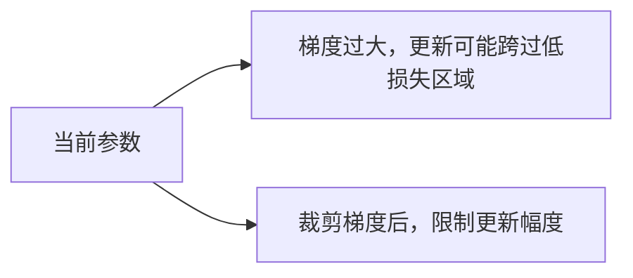

# Day 18：Gradient Clipping（梯度裁剪）

> 来源为《学习梯度累积》的 Day18 完整讲解与补充问答，保留原教学顺序、推导、例子和代码。原窗口交互图改为静态表达。归档程序见 [code.py](code.py)。

今天继续沿用你的 `FruitClassifier` 模型和 Day 17 的训练代码，在梯度累积的基础上加入梯度裁剪。

今天需要掌握四个核心知识点：

- 什么是梯度爆炸？
- 什么是梯度范数（Gradient Norm）？
- 梯度裁剪到底裁剪了什么？
- 如何在训练循环中使用 `clip_grad_norm_()`？

---

## 一、具体例子：参数更新幅度过大

假设模型只有一个参数 $w=10$，学习率为 0.1。

SGD 的参数更新公式：

$$
w_{\text{new}}=w-\eta g
$$

其中，$\eta$ 是学习率，$g$ 是梯度。

假设训练过程中出现不同大小的梯度：

| 当前参数 | 梯度 | 学习率 | 更新后参数 |
|--------|--------|--------|--------|
| 10 | 2 | 0.1 | 9.8 |
| 10 | 5 | 0.1 | 9.5 |
| 10 | 1000 | 0.1 | \-90 |

前两次更新都比较正常。

但是当梯度突然变得非常大时，参数就可能发生剧烈变化，导致训练不稳定，甚至出现 Loss NaN。

这就是梯度爆炸（Exploding Gradient）可能造成的问题。

## 二、设计动机：限制梯度的大小

既然梯度太大会导致参数更新幅度过大，那么我们能不能在更新之前，限制梯度的大小？

这就是梯度裁剪。



示意图：梯度裁剪限制梯度大小，降低参数更新过于剧烈的风险。

但是一个神经网络可能有几百万甚至几十亿个参数，每个参数都有自己的梯度。

那么，如何衡量整个模型的梯度到底有多大？

这就需要引入梯度范数。

---

## 三、专业概念与原理

### 1\. 什么是梯度范数？

假设一个模型只有三个参数，它们的梯度分别为：

```python
grad = [3, 4, 12]
```

如何用一个数字衡量这些梯度的整体大小？

最常见的方法是计算 L2 Norm（L2 范数）。

$$
\|g\|_2=\sqrt{3^2+4^2+12^2}=13
$$

在 PyTorch 中：

```python
grad = torch.tensor([3.0, 4.0, 12.0])

norm = torch.norm(grad)

print(norm)  # tensor(13.)
```

真实神经网络中，可以把所有可训练参数的梯度想象成一个巨大的向量，然后计算这个向量的 L2 范数。

**梯度范数就是衡量整个模型梯度大小的一个数字。**

### 2\. 梯度裁剪是如何实现的？

假设我们规定：

```python
max_norm = 5.0
```

但当前梯度为：

```python
grad = [3, 4, 12]
```

梯度范数为 13，超过了限制 5。

于是，将所有梯度统一乘上一个缩放系数：

$$
\text{scale}=\frac{5}{13}
$$

裁剪后的梯度：

$$
g'=g\times\frac{5}{13}
$$

| max_norm | 缩放系数（约） | 裁剪后范数（约） |
|---|---|---|
| 1 | 1/13 | 1 |
| 5 | 5/13 | 5 |
| 13 | 1 | 13 |
| 16 | 1 | 13 |

注意一个非常重要的特点：

**梯度裁剪不是将超过阈值的梯度直接砍掉，而是将所有梯度按相同比例缩小。**

这样可以保留原来的梯度方向，只改变梯度的大小。

| 向量 | 梯度 | L2范数 | 方向 |
|---|---|---|---|
| 原始 | `[3,4,12]` | 13 | 原方向 |
| 裁剪到5 | `[1.1538,1.5385,4.6154]` | 约5 | 与原方向相同 |

两个向量的方向完全相同，只是长度不同（二维示意）。

正式公式为：

$$
g_{\text{new}}=
g\times\min\left(1,\frac{\text{max\_norm}}{\|g\|_2}\right)
$$

范数没超过阈值，就保持不变；超过阈值，就同比例缩小。

---

## 四、代码实践：PyTorch 已经封装好了

你不需要自己计算所有参数的梯度范数，也不需要手动缩放梯度。

PyTorch 提供了：

```python
torch.nn.utils.clip_grad_norm_(
    model.parameters(),
    max_norm=1.0
)
```

参数含义：

| 参数 | 含义 |
|--------|--------|
| `model.parameters()` | 模型的所有参数，通过它们访问对应的 `.grad` |
| `max_norm=1.0` | 允许的最大梯度范数 |
| `norm_type=2.0` | 默认使用 L2 范数 |

### 1\. 梯度裁剪应该放在哪里？

必须放在 `backward()` 之后，`optimizer.step()` 之前。

```python
optimizer.zero_grad()

logits = model(batch_x)

loss = criterion(logits, batch_y)

loss.backward()

# Day18：梯度裁剪
torch.nn.utils.clip_grad_norm_(
    model.parameters(),
    max_norm=1.0
)

optimizer.step()
```

原因很简单：

- `backward()`：计算梯度。
- `clip_grad_norm_()`：修改梯度。
- `optimizer.step()`：使用修改后的梯度更新参数。

### 2\. 为什么函数名字最后有一个下划线？

```python
clip_grad_norm_()
```

PyTorch 中，很多以 `_` 结尾的操作表示 **In-place（原地操作）**。

这里意味着它会直接修改模型参数的 `.grad`。

因此，你不需要写：

```python
grad = torch.nn.utils.clip_grad_norm_(...)
```

来保存裁剪后的梯度。

不过，该函数确实有返回值：

```python
grad_norm = torch.nn.utils.clip_grad_norm_(
    model.parameters(),
    max_norm=1.0
)
```

**返回的是裁剪前的梯度总范数，而不是裁剪后的梯度。**

这在实际训练中非常有用，可以用来监控梯度是否异常。

### 3\. 先通过一个最小实验验证

```python
import torch
import torch.nn as nn

w = nn.Parameter(torch.tensor([1.0, 2.0, 3.0]))

# 人为设置梯度
w.grad = torch.tensor([3.0, 4.0, 12.0])

print("裁剪前梯度:", w.grad)
print("裁剪前范数:", w.grad.norm())

grad_norm = nn.utils.clip_grad_norm_(
    [w],
    max_norm=5.0
)

print("函数返回值:", grad_norm)
print("裁剪后梯度:", w.grad)
print("裁剪后范数:", w.grad.norm())
```

预期输出：

```text
裁剪前梯度: tensor([ 3.,  4., 12.])
裁剪前范数: tensor(13.)

函数返回值: tensor(13.)
裁剪后梯度: tensor([1.1538, 1.5385, 4.6154])
裁剪后范数: tensor(5.0000)
```

其中：

```python
[w]
```

是因为 `clip_grad_norm_()` 接收参数的可迭代对象。这里用列表传入一个参数，而真实训练中直接传入 `model.parameters()` 即可。

---

## 五、结合 Day 17：梯度累积 + 梯度裁剪

这是今天最重要的工程知识。

假设我们设置：

```python
accumulation_steps = 4
max_norm = 1.0
```

应该在每次 `backward()` 后裁剪，还是等四次梯度累积完成后再裁剪？

**答案：累积完成后再裁剪。**

核心代码：

```python
scaled_loss.backward()

if is_full_cycle or is_last_batch:

    # Day18：只在参数更新前进行裁剪
    nn.utils.clip_grad_norm_(
        model.parameters(),
        max_norm=1.0
    )

    optimizer.step()
    optimizer.zero_grad()
```

为什么不能每次累积都裁剪？

因为我们希望裁剪的是最终完整的大 Batch 梯度。如果在累积过程中提前裁剪，就可能改变不同 Micro Batch 梯度之间的贡献比例，最终得到错误的梯度方向或大小。

---

## 六、Day 18 完整代码

文件名：`gradient_clipping.py`

继续使用你之前的分类模型，保留 Day 17 的梯度累积机制，并增加裁剪前后的梯度范数监控。

```python

import torch
import torch.nn as nn
from torch.utils.data import TensorDataset, DataLoader

# ============================================
# 1. 固定随机种子
# ============================================

torch.manual_seed(42)

# ============================================
# 2. 创建合成训练数据
# ============================================

num_per_class = 100

class_0 = (
    torch.randn(num_per_class, 2) * 0.25
    + torch.tensor([1.0, 1.0])
)

class_1 = (
    torch.randn(num_per_class, 2) * 0.25
    + torch.tensor([3.0, 1.0])
)

class_2 = (
    torch.randn(num_per_class, 2) * 0.25
    + torch.tensor([2.0, 3.0])
)

x = torch.cat(
    [class_0, class_1, class_2],
    dim=0
)

y = torch.cat([
    torch.zeros(num_per_class, dtype=torch.long),
    torch.ones(num_per_class, dtype=torch.long),
    torch.full((num_per_class,), 2, dtype=torch.long)
])

print("X shape:", x.shape)
print("y shape:", y.shape)

# ============================================
# 3. Dataset 和 DataLoader
# ============================================

dataset = TensorDataset(x, y)

loader = DataLoader(
    dataset,
    batch_size=32,
    shuffle=True
)

# ============================================
# 4. 定义分类模型
# ============================================

class FruitClassifier(nn.Module):

    def __init__(self):
        super().__init__()

        self.network = nn.Sequential(
            nn.Linear(2, 16),
            nn.ReLU(),
            nn.Linear(16, 3)
        )

    def forward(self, x):
        return self.network(x)

# ============================================
# 5. 模型、损失函数、优化器
# ============================================

model = FruitClassifier()

criterion = nn.CrossEntropyLoss()

optimizer = torch.optim.SGD(
    model.parameters(),
    lr=0.1
)

# ============================================
# 6. 训练参数
# ============================================

num_epochs = 10

# Day17：梯度累积
accumulation_steps = 4

micro_batch_size = loader.batch_size

effective_batch_size = (
    micro_batch_size * accumulation_steps
)

# Day18：最大梯度范数
max_norm = 1.0

# ============================================
# 7. Day18：计算梯度总范数
# ============================================

def get_grad_norm(model):

    total_norm_squared = 0.0

    for param in model.parameters():

        # 有些参数可能没有梯度
        if param.grad is not None:

            # 当前参数张量的梯度 L2 范数
            param_norm = param.grad.norm(2).item()

            total_norm_squared += param_norm ** 2

    return total_norm_squared ** 0.5

# ============================================
# 8. 完整训练循环
# ============================================

for epoch in range(num_epochs):

    model.train()

    total_loss = 0
    total_correct = 0
    total_samples = 0

    # 梯度累积周期开始前清零
    optimizer.zero_grad()

    for batch_index, (batch_x, batch_y) in enumerate(loader):

        # 1. Forward
        logits = model(batch_x)

        # 2. Calculate Loss
        loss = criterion(logits, batch_y)

        # 3. 当前 Batch 样本数
        batch_size = batch_x.size(0)

        # 4. Day17：计算累积周期的实际样本数
        group_index = batch_index // accumulation_steps

        group_start = group_index * effective_batch_size

        group_size = min(
            effective_batch_size,
            len(dataset) - group_start
        )

        # 5. Day17：Loss 缩放
        scaled_loss = loss * batch_size / group_size

        # 6. Backward：累积梯度
        scaled_loss.backward()

        # 7. 判断是否需要更新参数
        is_full_cycle = (
            (batch_index + 1) % accumulation_steps == 0
        )

        is_last_batch = (
            (batch_index + 1) == len(loader)
        )

        if is_full_cycle or is_last_batch:

            # =================================
            # Day18：梯度裁剪
            # =================================

            # 直接修改 .grad
            # 返回裁剪前的梯度总范数
            grad_norm_before = nn.utils.clip_grad_norm_(
                model.parameters(),
                max_norm=max_norm
            ).item()

            # 计算裁剪后的梯度总范数
            grad_norm_after = get_grad_norm(model)

            # 打印梯度裁剪信息
            if epoch == 0:

                print(f"\nBatch {batch_index + 1}")

                print(
                    f"裁剪前梯度范数: "
                    f"{grad_norm_before:.6f}"
                )

                print(
                    f"裁剪后梯度范数: "
                    f"{grad_norm_after:.6f}"
                )

            # 8. 更新参数
            optimizer.step()

            # 9. 清零梯度
            optimizer.zero_grad()

        # 10. 统计 Loss
        total_loss += loss.item() * batch_size

        # 11. 计算预测正确数量
        predictions = torch.argmax(logits, dim=1)

        correct = (predictions == batch_y).sum().item()

        total_correct += correct

        total_samples += batch_size

    # ========================================
    # 9. 计算 Epoch 指标
    # ========================================

    avg_loss = total_loss / total_samples

    accuracy = total_correct / total_samples

    print(
        f"Epoch [{epoch + 1}/{num_epochs}] "
        f"Loss: {avg_loss:.4f} "
        f"Accuracy: {accuracy:.2%}"
    )

# ============================================
# 10. 训练结束
# ============================================

print("\n训练完成！")
```

## 七、重点讲解新增代码

实际上，相比 Day 17，今天只新增了两部分。

### 1\. 计算模型的梯度总范数

```python
def get_grad_norm(model):

    total_norm_squared = 0.0

    for param in model.parameters():

        if param.grad is not None:

            param_norm = param.grad.norm(2).item()

            total_norm_squared += param_norm ** 2

    return total_norm_squared ** 0.5
```

假设模型有两个参数张量：

```python
param1.grad = [3, 4]
param2.grad = [12]
```

第一个参数张量的范数为 5，第二个为 12。

整个模型的梯度范数就是：

$$
\sqrt{5^2+12^2}=13
$$

代码中的：

```python
param.grad.norm(2)
```

计算当前参数张量的 L2 范数。

```python
total_norm_squared += param_norm ** 2
```

累加每个参数梯度范数的平方。

```python
return total_norm_squared ** 0.5
```

最后开平方，得到整个模型的梯度总范数。

这个函数只是为了帮助你观察裁剪后的梯度，**实际进行梯度裁剪不需要自己实现这个函数。**

### 2\. 真正执行梯度裁剪

```python
grad_norm_before = nn.utils.clip_grad_norm_(
    model.parameters(),
    max_norm=max_norm
).item()
```

这一行实际上完成两件事：

- 将模型梯度的总范数限制在 `max_norm` 以内。
- 返回裁剪前的梯度总范数，供我们观察。

`.item()` 则是将单元素 Tensor 转换为 Python 数值。

## 八、运行代码时观察什么？

由于我们的分类模型比较简单，不一定会出现很大的梯度。

为了更明显地观察梯度裁剪的效果，你可以暂时修改：

```python
max_norm = 0.1
```

正常情况下，如果裁剪前的梯度范数超过 0.1，就会看到类似下面的结果（示意输出，并非实测）：

```text
裁剪前梯度范数: 0.753218
裁剪后梯度范数: 0.100000
```

不过，实际训练中阈值并不是越小越好。过小的阈值会限制正常的梯度，导致模型学习速度变慢。大模型训练中 `1.0` 是常见的选择之一，但不是固定标准。

---

## 九、Day 18 知识总结

| 知识点 | 核心内容 |
|--------|--------|
| 梯度爆炸 | 梯度过大，可能导致训练不稳定 |
| 梯度范数 | 衡量整个模型梯度的大小 |
| 梯度裁剪 | 按比例缩小梯度，保留梯度方向 |
| PyTorch API | `nn.utils.clip_grad_norm_()` |
| 返回值 | 裁剪前的梯度总范数 |
| 裁剪时机 | `backward()` 之后，`step()` 之前 |
| 结合梯度累积 | 所有梯度累积完成后再裁剪 |

今天真正需要熟练掌握的工程代码其实只有下面这几行：

```python
scaled_loss.backward()

if is_full_cycle or is_last_batch:

    nn.utils.clip_grad_norm_(
        model.parameters(),
        max_norm=1.0
    )

    optimizer.step()
    optimizer.zero_grad()
```

Day 17 解决的是**显存不足的问题**，Day 18 解决的是**梯度过大导致训练不稳定的问题**。这两个机制可以同时使用，也是实际大模型训练循环中的常见组成部分。

---

# 补充问答 · 原地裁剪后，返回值为什么仍是裁剪前范数

不是。这个函数同时做了两件事：

```python
grad_norm_before = nn.utils.clip_grad_norm_(
    model.parameters(),
    max_norm=1.0
).item()
```

- **原地修改**：直接裁剪模型参数的 `.grad`。
- **返回值**：返回裁剪之前的梯度总范数。

例如，原始梯度范数为 13，`max_norm=1.0`，执行后：

```python
grad_norm_before  # 13.0
```

但此时模型中 `.grad` 的总范数已经变成了约 1.0。

**原地修改的对象和函数的返回值是两回事。** 这是 PyTorch API 本身的设计。

## 归档修正

code.py 来自本地 gradient_clipping.py。将 scaled_loss=loss*batch_size 修正为 scaled_loss=loss*batch_size/group_size，与上文教学公式一致，按整个累积周期样本数取平均。原始本地文件保留。
