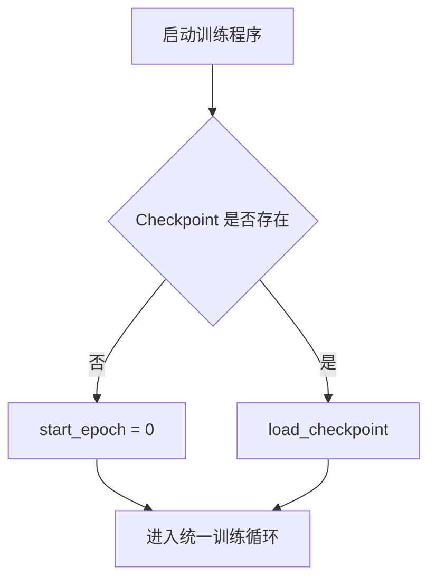

# Day 22：断点续训与实验日志

今天继续使用你的 `FruitClassifier` 水果分类项目，在 Day 21 的代码基础上进行升级，不再重新构建一个陌生的训练项目。

今天主要学习五个知识点：

| 知识点 | 解决什么问题 |
|--------|--------|
| Resume Training | 真正退出程序后继续训练 |
| Random State | 恢复随机数生成状态 |
| Logging | 持久化记录训练信息 |
| TensorBoard | 可视化 Loss、Accuracy、LR |
| Config | 统一管理实验参数 |

今天的重点依然是**代码和工程能力**。已经掌握的模型构建、前向传播、反向传播等内容不再重复讲解。

## 第一步：具体例子引入

假设你现在正在进行三个模型训练实验。

| 实验 | 优化器 | 学习率 | Batch Size |
|--------|--------|--------|--------|
| experiment\_01 | SGD | 0.1 | 32 |
| experiment\_02 | AdamW | 0.001 | 32 |
| experiment\_03 | AdamW | 0.001 | 64 |

三个实验分别训练了几个小时。

这时，你会遇到几个问题：

- 电脑关机后，如何自动读取之前的 Checkpoint？
- 恢复训练后，如何保证随机打乱的数据顺序能够接续？
- 如何知道每个实验使用了什么超参数？
- 如何查看过去几十轮的 Loss 和 Accuracy？
- 如何直观比较三个实验的训练效果？

这些问题已经不属于神经网络本身，而属于**模型训练工程管理**。

## 第二步：理解设计动机

Day 21 和 Day 22 的区别：

**Day 21：保存和恢复模型训练状态**

---

**Day 22：建立可持续运行的训练实验**

一个规范的训练项目，不能只关注模型最终的准确率，还必须能够回答：这个模型是怎么训练出来的？训练过程能否恢复？实验结果能否复现？

---

## 第三步：专业概念与原理

### 1\. Resume Training：真正的断点续训

在 Day 21 中，我们是这样模拟程序中断的：

```python
# 训练前5轮
for epoch in range(0, 5):
    ...

# 重新创建训练组件
model, criterion, optimizer, scheduler, scaler = build_training_objects()

# 加载Checkpoint
start_epoch, global_step = load_checkpoint(...)

# 训练后5轮
for epoch in range(start_epoch, 10):
    ...
```

但是现实中，程序可能已经完全退出了。

所以我们不应该写两个训练循环，而应该在程序启动的时候进行判断：

```python
import os

start_epoch = 0
global_step = 0

if os.path.exists(checkpoint_path):

    start_epoch, global_step = load_checkpoint(
        model,
        optimizer,
        scheduler,
        scaler
    )
```

这里新增了一个 Python 方法：

```python
os.path.exists(checkpoint_path)
```

它用于判断指定路径是否存在。

- 文件存在：返回 `True`。
- 文件不存在：返回 `False`。

接下来只需要一个训练循环：

```python
for epoch in range(start_epoch, num_epochs):

    # 训练
    ...

    # 保存Checkpoint
    ...
```



这样，无论你什么时候关闭程序，下一次启动时都可以从最近一次成功保存的 Checkpoint 继续训练。

这才是真正的 Resume Training。

### 2\. Random State：随机数状态恢复

这是今天原理上最需要理解的部分。

你之前一直在使用：

```python
torch.manual_seed(42)
```

但是你可能没有意识到，**随机种子和随机数状态并不是一回事。**

#### 2.1 随机种子是什么？

随机数生成器并不是真的随意生成数字，而是根据内部算法和当前状态生成数字。

假设随机种子为 42，生成的随机数序列如下（仅用于示意）：

**模拟随机数生成器** Seed = 42

当前状态：已生成  个随机数

[生成下一个]

[保存当前状态]

[重新设置种子]

[恢复保存的状态]

试着生成三个随机数，保存状态，再重置种子，最后恢复状态，观察区别。

重新设置种子：

```python
torch.manual_seed(42)
```

相当于回到随机数序列的起点。

而恢复随机数状态，相当于回到上一次生成随机数的位置。

#### 2.2 为什么训练需要恢复随机数状态？

你的代码中至少有三个地方使用了随机数：

```python
# 1. 随机生成训练数据
torch.randn(num_per_class, 2)

# 2. 随机初始化模型参数
model = FruitClassifier()

# 3. 每轮随机打乱数据
loader = DataLoader(
    dataset,
    batch_size=32,
    shuffle=True
)
```

除此之外，真实的大模型训练还可能使用 Dropout、随机采样、随机数据增强等操作。

假设正常训练时：

| 训练轮次 | 样本访问顺序（示意） |
|--------|--------|
| Epoch 1 | 3、1、2、4 |
| Epoch 2 | 2、4、1、3 |
| Epoch 3 | 4、3、2、1 |

如果 Epoch 2 结束后关闭程序，重新设置种子，但是没有恢复随机数状态，那么 Epoch 3 的样本顺序可能就发生变化。

模型虽然能够继续训练，但训练轨迹可能和 uninterrupted training（不中断的训练）不同。

#### 2.3 如何获取和恢复随机数状态？

PyTorch 已经封装好了相关方法。

```python
# 获取CPU随机数生成器状态
rng_state = torch.get_rng_state()

# 恢复CPU随机数生成器状态
torch.set_rng_state(rng_state)
```

注意：

```python
torch.get_rng_state()
```

返回的是一个记录随机数生成器内部状态的 Tensor，而不是一个简单的整数种子。

我们来写一个最小例子：

```python
import torch

torch.manual_seed(42)

print(torch.rand(3))

# 保存当前随机数状态
state = torch.get_rng_state()

a = torch.rand(3)

# 恢复之前的状态
torch.set_rng_state(state)

b = torch.rand(3)

print(a)
print(b)

print(torch.equal(a, b))
```

最后会输出：

```text
True
```

因为 `a` 和 `b` 都是在同一个随机数状态下生成的。

#### 2.4 不同随机数生成器需要分别保存

在工业训练项目中，随机数不一定全部来自 PyTorch。

| 随机数来源 | 获取状态 | 恢复状态 |
|--------|--------|--------|
| Python | `random.getstate()` | `random.setstate()` |
| NumPy | `np.random.get_state()` | `np.random.set_state()` |
| PyTorch CPU | `torch.get_rng_state()` | `torch.set_rng_state()` |
| PyTorch CUDA | `torch.cuda.get_rng_state_all()` | `torch.cuda.set_rng_state_all()` |

今天的水果分类项目只使用 PyTorch 的随机数，因此我们只需要保存 CPU 和 CUDA 的随机数状态。

在 Day 21 的 Checkpoint 字典中新增：

```python
checkpoint = {
    # 原来的训练状态
    ...

    # 新增随机数状态
    "cpu_rng_state": torch.get_rng_state(),

    "cuda_rng_state": (
        torch.cuda.get_rng_state_all()
        if torch.cuda.is_available()
        else None
    )
}
```

恢复时：

```python
torch.set_rng_state(
    checkpoint["cpu_rng_state"].cpu()
)

if torch.cuda.is_available():
    if checkpoint["cuda_rng_state"] is not None:

        torch.cuda.set_rng_state_all([
            state.cpu()
            for state in checkpoint["cuda_rng_state"]
        ])
```

**特别注意：随机数状态应当在模型等组件创建完成后、下一次训练开始之前恢复。**

因为创建模型本身就可能消耗随机数。如果先恢复随机数状态，再创建模型，就会改变刚刚恢复的状态。

另外，恢复随机数状态不代表任何训练环境下都能达到逐位一致的结果。硬件、非确定性算子、并行 DataLoader 等因素也会影响复现。今天先实现单进程、Epoch 边界的续训。

### 3\. Logging：日志记录

你之前一直使用：

```python
print(
    f"Epoch [{epoch + 1}/{num_epochs}] "
    f"Loss: {avg_loss:.4f}"
)
```

但 `print()` 有一个问题：关闭终端后，之前的输出可能就找不到了。

实际工程中，我们通常使用 Python 自带的 `logging` 模块。

#### 3.1 最基本的使用方式

```python
import logging

logging.basicConfig(
    level=logging.INFO,
    format="%(asctime)s | %(levelname)s | %(message)s"
)

logging.info("开始训练")
logging.info("Epoch 1: Loss = 0.85")
```

输出示例：

```text
2026-11-19 16:30:01 | INFO | 开始训练
2026-11-19 16:30:02 | INFO | Epoch 1: Loss = 0.85
```

这里的 `format` 是日志输出格式。

| 参数 | 含义 |
|--------|--------|
| `%(asctime)s` | 当前时间 |
| `%(levelname)s` | 日志级别 |
| `%(message)s` | 日志内容 |

#### 3.2 日志级别

| 级别 | 用途 |
|--------|--------|
| `DEBUG` | 调试信息 |
| `INFO` | 正常运行信息 |
| `WARNING` | 警告 |
| `ERROR` | 运行错误 |
| `CRITICAL` | 严重错误 |

我们训练时记录 Loss、Accuracy 等信息，使用 `INFO` 即可。

#### 3.3 同时输出到终端和文件

这是工程中比较常见的写法：

```python
logging.basicConfig(
    level=logging.INFO,

    format="%(asctime)s | %(levelname)s | %(message)s",

    handlers=[
        logging.FileHandler("train.log", mode="a", encoding="utf-8"),
        logging.StreamHandler()
    ]
)
```

重点理解 `handlers`。

它是一个列表，里面存放不同的日志处理器。

- `FileHandler`：将日志写入文件。
- `StreamHandler`：将日志输出到终端（默认是标准错误流）。
- `mode="a"`：追加写入，而不是覆盖之前的日志。

以后你就可以用：

```python
logging.info(f"Epoch {epoch + 1} | Loss: {avg_loss:.4f}")
```

替代训练过程中的 `print()`。

---

### 4\. TensorBoard：训练过程可视化

假设你训练了100个 Epoch。

如果所有信息都以文字输出，你很难直观观察模型的学习趋势。

TensorBoard 就是用来解决这个问题的。

TensorBoard 训练曲线示意（模拟数据）

**Train Loss**

> 原窗口交互曲线转换为静态数据表，以下为教学示意数据。

| epoch | Train Loss |
|---|---|
| 1 | 1.08 |
| 2 | 0.89 |
| 3 | 0.65 |
| 4 | 0.42 |
| 5 | 0.29 |
| 6 | 0.21 |
| 7 | 0.15 |
| 8 | 0.12 |
| 9 | 0.1 |
| 10 | 0.09 |

---

**Train Accuracy**

> 原窗口交互曲线转换为静态数据表，以下为教学示意数据。

| epoch | Accuracy |
|---|---|
| 1 | 38 |
| 2 | 52 |
| 3 | 73 |
| 4 | 85 |
| 5 | 91 |
| 6 | 94 |
| 7 | 96 |
| 8 | 97 |
| 9 | 98 |
| 10 | 99 |

---

**Learning Rate（每轮训练实际使用的学习率）**

> 原窗口交互曲线转换为静态数据表，以下为教学示意数据。

| epoch | Learning Rate |
|---|---|
| 1 | 0.1 |
| 2 | 0.1 |
| 3 | 0.1 |
| 4 | 0.05 |
| 5 | 0.05 |
| 6 | 0.05 |
| 7 | 0.025 |
| 8 | 0.025 |
| 9 | 0.025 |
| 10 | 0.0125 |

#### 4.1 安装 TensorBoard

在终端执行：

```bash
pip install tensorboard
```

#### 4.2 创建 SummaryWriter

```python
from torch.utils.tensorboard import SummaryWriter

writer = SummaryWriter(
    log_dir="runs/fruit_exp01"
)
```

`SummaryWriter` 是 PyTorch 提供的 TensorBoard 数据记录工具。

它负责将训练指标写入事件文件，TensorBoard 再读取这些文件并绘制曲线。（[PyTorch TensorBoard 文档](https://docs.pytorch.org/docs/stable/tensorboard.html)）

#### 4.3 记录训练指标

```python
writer.add_scalar(
    "Loss/train",
    avg_loss,
    epoch + 1
)
```

逐个解释参数：

| 参数 | 含义 |
|--------|--------|
| `"Loss/train"` | 指标名称 |
| `avg_loss` | Y轴数值 |
| `epoch + 1` | X轴数值 |

例如：

```python
writer.add_scalar("Loss/train", 0.8, 1)
writer.add_scalar("Loss/train", 0.5, 2)
writer.add_scalar("Loss/train", 0.3, 3)
```

就是在记录三个坐标点：

> 原窗口交互曲线转换为静态数据表，以下为教学示意数据。

| Epoch | Loss |
|---|---|
| 1 | 0.8 |
| 2 | 0.5 |
| 3 | 0.3 |

同样，我们可以记录 Accuracy 和 Learning Rate：

```python
writer.add_scalar("Accuracy/train", accuracy, epoch + 1)

writer.add_scalar("LearningRate", current_lr, epoch + 1)
```

训练结束后：

```python
writer.close()
```

关闭 Writer，并将剩余的缓冲数据写入文件。

#### 4.4 如何打开 TensorBoard？

运行训练代码后，在终端执行：

```bash
tensorboard --logdir=runs
```

然后使用浏览器访问：

[http://localhost:6006](http://localhost:6006)

你就可以看到自己的训练曲线。

注意，TensorBoard 主要负责读取和展示指标，不负责训练模型。

---

### 5\. Config：实验配置管理

你之前的训练代码中，参数分散在各个位置。

```python
num_per_class = 100

batch_size = 32

num_epochs = 10

optimizer = torch.optim.SGD(
    model.parameters(),
    lr=0.1
)
```

如果实验越来越复杂，参数可能有几十甚至上百个，修改和管理就会很困难。

所以，工程中通常会统一管理配置。

最简单的方式就是使用字典：

```python
config = {
    "seed": 42,
    "num_per_class": 100,
    "batch_size": 32,
    "num_epochs": 10,
    "learning_rate": 0.1,
    "momentum": 0.9,
    "scheduler_step_size": 3,
    "scheduler_gamma": 0.5
}
```

需要使用某个参数时：

```python
loader = DataLoader(
    dataset,
    batch_size=config["batch_size"],
    shuffle=True
)
```

优化器也是一样：

```python
optimizer = torch.optim.SGD(
    model.parameters(),
    lr=config["learning_rate"],
    momentum=config["momentum"]
)
```

#### 如何将配置保存到文件？

使用 Python 自带的 `json` 模块。

```python
import json

with open("config.json", "w", encoding="utf-8") as f:

    json.dump(config, f, indent=4)
```

这里的代码需要理解：

- `open()`：打开文件。
- `"w"`：写入模式。
- `as f`：将打开的文件对象命名为 `f`。
- `json.dump()`：将 Python 对象以 JSON 格式写入文件。
- `indent=4`：使用4个空格缩进，让文件更容易阅读。
- `with`：执行结束后自动关闭文件。

这样，即使几个月后你重新查看这个实验，也可以知道当时使用了什么超参数。

# 第四步：整合 Day 22 新增代码

到目前为止，我们已经分别认识了今天所有的核心 API。

下面重点理解几个整合时的工程细节。

## 1\. 为每个实验创建独立目录

```python
import os

experiment_dir = "runs/fruit_exp01"

os.makedirs(experiment_dir, exist_ok=True)
```

`os.makedirs()` 用于创建目录，包括不存在的父级目录。

`exist_ok=True` 表示如果目录已经存在，不报错。

然后：

```python
checkpoint_path = os.path.join(
    experiment_dir,
    "checkpoint.pth"
)
```

`os.path.join()` 用于拼接文件路径。

你的实验最终会形成这样的目录结构：

**runs/**

**fruit\_exp01/**

config.json
实验配置

checkpoint.pth
训练状态

train.log
文本日志

tensorboard/

events.out.tfevents...

以后要开启新实验，只需要换一个目录名称。

## 2\. 保存 Checkpoint 时防止文件损坏

Day 21 中我们直接：

```python
torch.save(checkpoint, checkpoint_path)
```

假如正在覆盖旧 Checkpoint 时突然断电，可能导致旧文件和新文件都无法使用。

一种更稳妥的方法是：

```python
temp_path = checkpoint_path + ".tmp"

torch.save(checkpoint, temp_path)

os.replace(temp_path, checkpoint_path)
```

执行过程：

```text
旧 checkpoint.pth 保留
        ↓
将新状态写入 checkpoint.pth.tmp
        ↓
写入成功后替换旧 checkpoint.pth
```

这是一种常见的原子替换思路，可以降低保存过程中程序意外中断导致文件损坏的风险。

## 3\. 恢复训练后的 TensorBoard

假设已经完成 Epoch 5，下一次需要从 Epoch 6 开始。

```python
writer = SummaryWriter(
    log_dir=tensorboard_dir,
    purge_step=start_epoch + 1
)
```

这里的 `purge_step` 用于隐藏旧日志中从恢复位置开始的残留事件，避免中断前产生的部分记录与重新训练产生的记录冲突。恢复时需要使用相同的日志目录。（[PyTorch TensorBoard 文档](https://docs.pytorch.org/docs/stable/tensorboard.html)）

由于我们记录指标时使用的是 `epoch + 1`，因此恢复位置也必须使用同样的编号规则。

---

# 第五步：Day 22 完整代码

`experiment_logging.py`

这次依然保留你的水果分类数据集、网络结构、SGD 优化器和原有训练逻辑。

我们将 Day 21 的两个训练循环合并为一个，并增加自动断点恢复、随机数状态、日志、TensorBoard 和配置管理。

> 接口在本节完整代码的 `load_checkpoint()` 中途截断，未取得后续原文。下面以本地完整 `experiment_logging.py` 练习替换这一不完整代码块；归档版仅将实验目录改到脚本旁。前面的概念讲解均保留。

```python
import os
import json
import logging

import torch
import torch.nn as nn

from torch.utils.data import TensorDataset, DataLoader
from torch.utils.tensorboard import SummaryWriter


# ============================================
# 1. 实验配置
# ============================================

config = {
    "seed": 42,
    "num_per_class": 100,
    "batch_size": 32,
    "num_epochs": 10,
    "learning_rate": 0.1,
    "momentum": 0.9,
    "scheduler_step_size": 3,
    "scheduler_gamma": 0.5
}

from pathlib import Path

experiment_dir = str(Path(__file__).resolve().parent / "runs" / "fruit_exp01")

# 用于模拟训练中断
# 第一次运行设置为5
# 第二次运行修改为None
stop_after_epoch = 5


# ============================================
# 2. 创建实验目录
# ============================================

os.makedirs(experiment_dir, exist_ok=True)

checkpoint_path = os.path.join(
    experiment_dir, "checkpoint.pth"
)

config_path = os.path.join(
    experiment_dir, "config.json"
)

log_path = os.path.join(
    experiment_dir, "train.log"
)

tensorboard_dir = os.path.join(
    experiment_dir, "tensorboard"
)


# ============================================
# 3. 保存或检查实验配置
# ============================================

if os.path.exists(config_path):

    with open(config_path, "r", encoding="utf-8") as f:
        old_config = json.load(f)

    if old_config != config:
        raise ValueError(
            "实验配置发生变化，请使用新的实验目录"
        )

else:

    with open(config_path, "w", encoding="utf-8") as f:

        json.dump(config, f, indent=4)


# ============================================
# 4. 初始化 Logging
# ============================================

logging.basicConfig(

    level=logging.INFO,

    format="%(asctime)s | %(levelname)s | %(message)s",

    handlers=[
        logging.FileHandler(
            log_path,
            mode="a",
            encoding="utf-8"
        ),

        logging.StreamHandler()
    ]
)

logger = logging.getLogger(__name__)


# ============================================
# 5. 随机种子与设备
# ============================================

torch.manual_seed(config["seed"])

device = torch.device(
    "cuda" if torch.cuda.is_available() else "cpu"
)

use_amp = device.type == "cuda"

logger.info(f"当前设备: {device}")


# ============================================
# 6. 创建合成训练数据
# ============================================

num_per_class = config["num_per_class"]

class_0 = (
    torch.randn(num_per_class, 2) * 0.25
    + torch.tensor([1.0, 1.0])
)

class_1 = (
    torch.randn(num_per_class, 2) * 0.25
    + torch.tensor([3.0, 1.0])
)

class_2 = (
    torch.randn(num_per_class, 2) * 0.25
    + torch.tensor([2.0, 3.0])
)

x = torch.cat(
    [class_0, class_1, class_2],
    dim=0
)

y = torch.cat([
    torch.zeros(num_per_class, dtype=torch.long),
    torch.ones(num_per_class, dtype=torch.long),
    torch.full((num_per_class,), 2, dtype=torch.long)
])


# ============================================
# 7. Dataset 和 DataLoader
# ============================================

dataset = TensorDataset(x, y)

loader = DataLoader(
    dataset,
    batch_size=config["batch_size"],
    shuffle=True,
    num_workers=0
)

logger.info(f"样本总数: {len(dataset)}")

logger.info(f"每轮Batch数量: {len(loader)}")


# ============================================
# 8. 定义分类模型
# ============================================

class FruitClassifier(nn.Module):

    def __init__(self):

        super().__init__()

        self.network = nn.Sequential(
            nn.Linear(2, 16),
            nn.ReLU(),
            nn.Linear(16, 3)
        )

    def forward(self, x):

        return self.network(x)


# ============================================
# 9. 创建训练组件
# ============================================

model = FruitClassifier().to(device)

criterion = nn.CrossEntropyLoss()

optimizer = torch.optim.SGD(
    model.parameters(),
    lr=config["learning_rate"],
    momentum=config["momentum"]
)

scheduler = torch.optim.lr_scheduler.StepLR(
    optimizer,
    step_size=config["scheduler_step_size"],
    gamma=config["scheduler_gamma"]
)

scaler = torch.amp.GradScaler(
    "cuda",
    enabled=use_amp
)


# ============================================
# 10. 训练一个 Epoch
# ============================================

def train_one_epoch(global_step):

    model.train()

    total_loss = 0
    total_correct = 0
    total_samples = 0

    for batch_index, (batch_x, batch_y) in enumerate(loader):

        batch_x = batch_x.to(device)
        batch_y = batch_y.to(device)

        # 1. 清零梯度
        optimizer.zero_grad()

        # 2. Forward + Loss
        with torch.autocast(
            device_type=device.type,
            dtype=torch.float16 if use_amp else torch.bfloat16,
            enabled=use_amp
        ):

            logits = model(batch_x)

            loss = criterion(logits, batch_y)

        # 3. Backward
        scaler.scale(loss).backward()

        # 4. Optimizer Step
        old_scale = scaler.get_scale()

        scaler.step(optimizer)

        scaler.update()

        # 仅统计未因AMP溢出而跳过的更新
        if scaler.get_scale() >= old_scale:

            global_step += 1

        # 5. 统计 Loss
        batch_size = batch_x.size(0)

        total_loss += loss.item() * batch_size

        # 6. 统计 Accuracy
        predictions = torch.argmax(logits, dim=1)

        correct = (
            predictions == batch_y
        ).sum().item()

        total_correct += correct

        total_samples += batch_size

    avg_loss = total_loss / total_samples

    accuracy = total_correct / total_samples

    return avg_loss, accuracy, global_step


# ============================================
# 11. 保存 Checkpoint
# ============================================

def save_checkpoint(epoch, global_step):

    checkpoint = {

        # Day 21：训练状态
        "model_state_dict": model.state_dict(),

        "optimizer_state_dict": optimizer.state_dict(),

        "scheduler_state_dict": scheduler.state_dict(),

        "scaler_state_dict": scaler.state_dict(),

        "epoch": epoch,

        "global_step": global_step,

        "config": config,

        "device_type": device.type,

        # Day 22：随机数状态
        "cpu_rng_state": torch.get_rng_state(),

        "cuda_rng_state": (
            torch.cuda.get_rng_state_all()
            if use_amp
            else None
        )
    }

    # 先保存到临时文件
    temp_path = checkpoint_path + ".tmp"

    torch.save(checkpoint, temp_path)

    # 保存成功后替换旧文件
    os.replace(temp_path, checkpoint_path)

    logger.info("Checkpoint 保存成功")


# ============================================
# 12. 加载 Checkpoint
# ============================================

def load_checkpoint():

    checkpoint = torch.load(
        checkpoint_path,
        map_location="cpu",
        weights_only=True
    )

    if checkpoint["config"] != config:

        raise ValueError("Checkpoint 配置不一致")

    if checkpoint["device_type"] != device.type:

        raise ValueError("续训设备类型发生变化")

    # 恢复模型参数
    model.load_state_dict(
        checkpoint["model_state_dict"]
    )

    # 恢复优化器状态
    optimizer.load_state_dict(
        checkpoint["optimizer_state_dict"]
    )

    # 恢复Scheduler状态
    scheduler.load_state_dict(
        checkpoint["scheduler_state_dict"]
    )

    # 恢复AMP状态
    scaler.load_state_dict(
        checkpoint["scaler_state_dict"]
    )

    # 恢复训练进度
    start_epoch = checkpoint["epoch"] + 1

    global_step = checkpoint["global_step"]

    # 恢复CPU随机数状态
    torch.set_rng_state(
        checkpoint["cpu_rng_state"]
    )

    # 恢复CUDA随机数状态
    if use_amp:

        torch.cuda.set_rng_state_all(
            checkpoint["cuda_rng_state"]
        )

    return start_epoch, global_step


# ============================================
# 13. 判断是否需要断点续训
# ============================================

start_epoch = 0

global_step = 0

is_resume = os.path.exists(checkpoint_path)

if is_resume:

    start_epoch, global_step = load_checkpoint()

    logger.info("Checkpoint 加载成功")

    logger.info(f"已完成Epoch: {start_epoch}")

    logger.info(f"恢复Global Step: {global_step}")

else:

    logger.info("未发现Checkpoint，从头开始训练")


# ============================================
# 14. 创建 TensorBoard Writer
# ============================================

writer = SummaryWriter(
    log_dir=tensorboard_dir,

    purge_step=(
        start_epoch + 1
        if is_resume
        else None
    )
)


# ============================================
# 15. 完整训练循环
# ============================================

num_epochs = config["num_epochs"]

try:

    for epoch in range(start_epoch, num_epochs):

        # 记录当前Epoch实际使用的学习率
        current_lr = optimizer.param_groups[0]["lr"]

        # 训练一个Epoch
        avg_loss, accuracy, global_step = train_one_epoch(
            global_step
        )

        # 更新下一轮使用的学习率
        scheduler.step()

        # ------------------------------------
        # 1. 记录文本日志
        # ------------------------------------

        logger.info(
            f"Epoch [{epoch + 1}/{num_epochs}] | "
            f"Loss: {avg_loss:.4f} | "
            f"Accuracy: {accuracy:.2%} | "
            f"LR: {current_lr:.6f} | "
            f"Global Step: {global_step}"
        )

        # ------------------------------------
        # 2. 记录TensorBoard
        # ------------------------------------

        writer.add_scalar(
            "Loss/train",
            avg_loss,
            epoch + 1
        )

        writer.add_scalar(
            "Accuracy/train",
            accuracy,
            epoch + 1
        )

        writer.add_scalar(
            "LearningRate",
            current_lr,
            epoch + 1
        )

        writer.flush()

        # ------------------------------------
        # 3. 保存Checkpoint
        # ------------------------------------

        save_checkpoint(epoch, global_step)

        # ------------------------------------
        # 4. 模拟程序中断
        # ------------------------------------

        if stop_after_epoch == epoch + 1:

            logger.warning("模拟训练中断，退出训练循环")

            break

    else:

        logger.info("全部训练完成！")

except KeyboardInterrupt:

    logger.warning(
        "用户中断训练，下次从最近的Checkpoint恢复"
    )

finally:

    writer.close()
```

## 归档补充：运行与续训

以下为归档说明，并非未取得的原文。第一次运行在第5轮结束保存并退出；再次运行会自动从第6轮继续。也可以按窗口注释把 `stop_after_epoch` 改为 `None`，其他 config 保持一致。相同实验目录中的 config 不一致会被拒绝；新实验应使用新目录。`python -m tensorboard.main --logdir day22/runs` 可查看日志，需先安装 `tensorboard`。本例只有 PyTorch 随机源、`num_workers=0`，在 Epoch 边界恢复；不支持任意 Batch 中途的精确接续。Python random、NumPy、独立 Generator 或多进程增强如被使用，需分别管理其随机状态。来源：[《学习模型检查点保存》](https://chatgpt.com/c/6afeab87-2860-83e9-a278-bbd28e8b44dc)。
